# Progression

Visual version history for procgen_maps. Each entry shows what the generator
actually produced at that point — screenshots and renders, not just commit
messages. Presets/seeds are noted so any image can be reproduced exactly.

---

## v0.15.0 — Polish and release (current)

The release that makes the map look like a place. v0.14's country road
ran through a pale beige plain that ended in a cliff against a grey
void; v0.15 gives the city a countryside, hides the map's edge, tidies
the UI, adds custom presets, audits every module and ships a README,
changelog, release zip and showcase media. `pytest` (257 tests), the
headless smoke test (now also checking the landscape attributes, the
horizon, the custom-preset round trip and that the GLB leaves the
horizon out) and the 50-seed x 4-preset fuzz validator are green.

**Landscape** (`generators/landscape.py`, pure numpy). Outside the city
the ground is a jittered-grid Voronoi of ~85 m field cells, each with a
random tone the terrain shader maps to meadow greens, a dark crop,
ripening barley, golden stubble or ploughed earth; a random 60% of the
cell borders carry a hedgerow (a dark 5 m band in the shader, trees
every few metres along it); the forest ring is multiplied by a
low-frequency clump mask so the trees stand in woods, with the humus
floor only under the dense cores. One function set feeds both the
shader - the terrain operator writes the masks as per-vertex attributes
(`procgen_maps_field`, `_field_tone`, `_hedge`, `_forest`), rewritten on
a city-only regenerate for the city's seed - and the prop planner, so
ground and vegetation agree exactly. The horizon: a skirt from the
terrain's edge loop slopes 160 m down into a flat far ground 8 km out
(`ProcgenMaps_Horizon`, terrain material, kept out of framing, stats,
SVG and the game export), the aerial-perspective haze is now
scene-referred bright (`HAZE_BRIGHTNESS`; it used to fade everything to
a *dark* grey-blue, which was the "void"), and the sky's below-horizon
band is painted in the same tone, so land, haze and sky meet. The day
exposure went from -2.4 to -2.7 EV and the ground palette darker and
more saturated - under the physical sky, anything paler renders beige.
Country roads got a grass verge in the terrain material that slopes
from the asphalt edge down into the ground (the v0.14 vertical asphalt
skirt read as a floating road with a black outline); the validator
skips the verge faces when it checks the terrain against the road
surfaces.

**UI/UX.** Sub-panels per concern (Generate, Lighting, Custom Presets,
Showcase Render, Export, Validate & Stats), a tooltip on every property,
a last-message line under Generate All, a timed line per stage in the
console, and `_safe_execute` around every operator: an unexpected error
is one clean message (traceback in the console), never a popup
traceback. Custom presets (`config/user_presets.py`): the whole panel
state as a JSON file in `bpy.utils.user_resource('CONFIG')/procgen_maps/
presets`, save / load / delete / open-folder buttons, tested in pure
Python and in the smoke test.

**Audit.** 83 docstrings added to public functions and classes, two
unused imports removed, the horizon excluded everywhere it would have
leaked (showcase bounds, SVG, stats, GLB), `package_release.py` takes an
output directory, and the forest-ring test was rewritten for the clumped
forest (density per area inside vs. outside 1.5 x radius).

All v0.15 stills are 1280x720 Cycles CPU previews (8-12 samples +
denoise) taken from the look tests and the flyover's own frames - the
planned 1920x1080 golden-hour and night hero stills were not rendered in
time and are the first item for v0.15.1.

**Kleinstadt, seed 4 - the city in its countryside (frame 1 of the flyover, the README hero):**
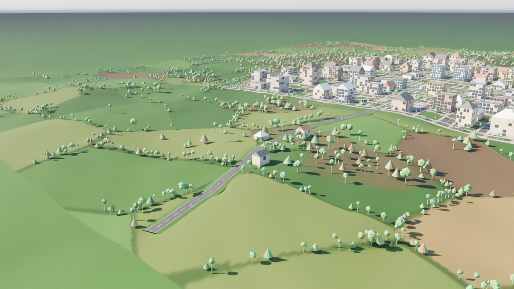

**Kleinstadt, seed 4 - the country road and village, the same view as v0.14's (compare below):**
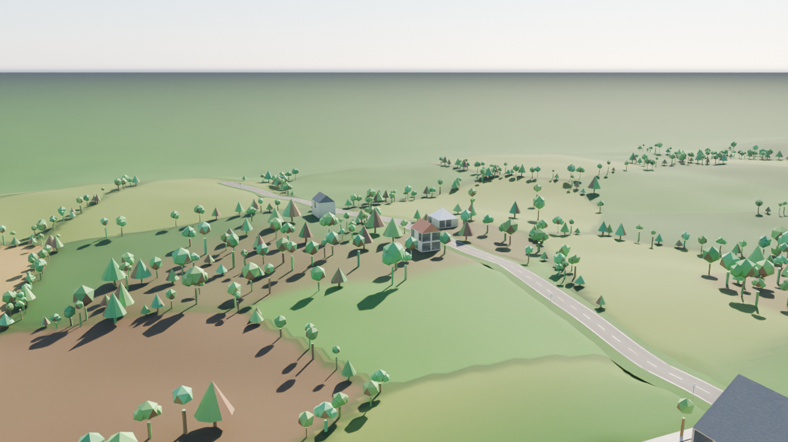

**Metropole, seed 12 - overview with the field patchwork around it:**
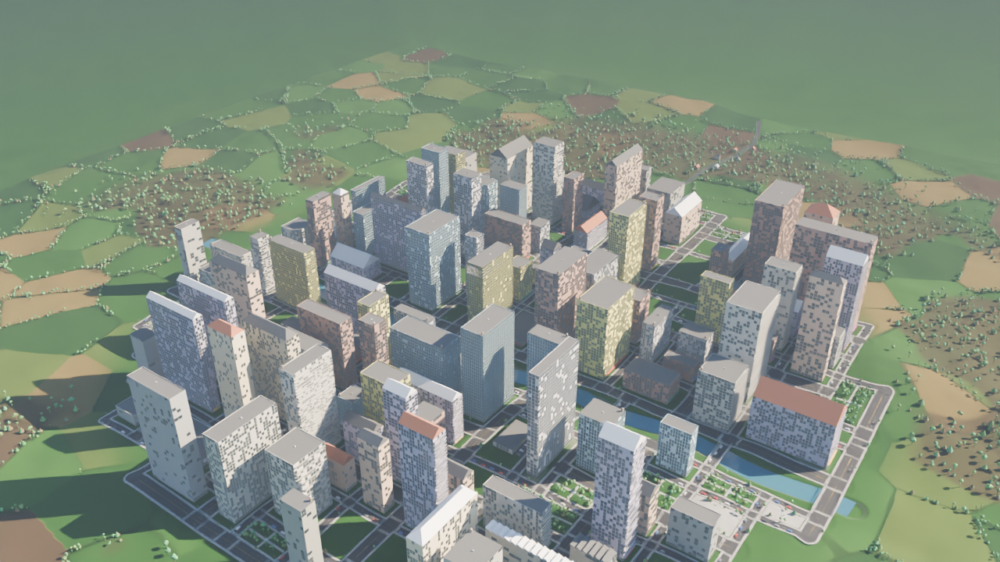

**Flyover** (Kleinstadt, seed 4, 10 s, 240 frames at 24 fps, 1280x720, Cycles CPU 12 samples + denoise, 6.5 MB H.264): [v0.15.0-flyover.mp4](docs/progression/v0.15.0-flyover.mp4)
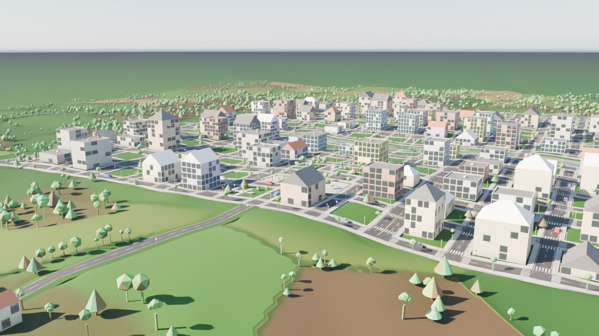

---

## v0.14.0 — World, dungeon, game export

The "what is it for" release: the generated map now goes into a game
engine as something a character can walk on, the dungeon is a dungeon
(themes, doors, two levels with a staircase, light), and the city sits
in a landscape instead of on a green disc. `pytest` (246 tests), the
headless smoke test (which now re-imports the exported GLB) and the
50-seed x 4-preset fuzz validator are green; the dungeon has its own
50-seed x 3-theme fuzz over `validate_dungeon`.

**Bridges and balconies (the v0.13 review).** The bridge railings were
one 1.1 m solid box per side and read as a concrete wall; now each side
is a 0.35 m parapet kerb with posts every 2 m, a mid rail and a top
rail, the deck has a fascia band along its edge and an arched soffit
from the deck down to the pier, so the bridge reads as a bridge from
the river side. Balcony railings were a full-height near-black box;
they are a slim panel to two thirds of the height plus a top rail in a
light grey trim material (also used for rooftop gear).

**Game-engine export** (`exporters/game_export.py`). The glTF export is
now a game export: every generated object is parented under `City` /
`Terrain` / `Dungeon` root nodes with readable group names; every
building becomes a `<name>` group with `<name>_LOD0` (the facade mesh)
and `<name>_LOD1` (one box in the same facade shading), every prop
instance expands to `<asset>_LOD0` / `_LOD1` (its high and low detail
master meshes, still shared); buildings and props get box colliders
(trees: trunk only, so agents walk under the canopy), the terrain,
streets, bridges, park paths and dungeon rooms are trimesh colliders;
and `Ground_Walkable` (the terrain downsampled to ~160 vertices a side
plus streets and park paths) and `Dungeon_Walkable` (room floors and
corridors only) are navmesh-friendly meshes. Naming follows Godot's
scene importer (`-col`, `-colonly`, `-navmesh`) or Unity (`_col` under
a `Collision` group, `_LOD0/_LOD1` for automatic LODGroups). All of it
is temporary scene surgery around one `export_scene.gltf` call and is
restored afterwards - the smoke test checks that the scene is unchanged
and that the re-imported GLB has 3 roots, 1,022 colliders, 755 LOD pairs
and 2 walkable meshes for the Dorf.

**Dungeon.** `DungeonParams.levels` (2 by default, up to 4) stacks BSP
levels 3.5 m apart; `plan_stairs` finds the pair of rooms (one per
level) whose plan-view overlap fits a 4.2 x 1.8 m flight with clearance
and centres it there; the upper room's floor and the lower room's
ceiling get a hole with a shaft between, the flight is 14 steps with a
parapet around the hole; pillars, the dais and the props keep off it.
Every doorway now has a lintel (the gap used to run to the ceiling) and
a door standing ajar (an iron gate in the crypt, oak in the castle, none
in the cave). Three themes change the stone, door and prop materials
and the room props: sarcophagi in rows (crypt), boulders (cave), wall
banners (castle). Lighting: torches on the long walls every 7 m in
addition to the doorway torches, and one dim, soft fill light per room
in the theme's tint. The start room is the smallest on the top level,
the boss hall the largest on the lowest. `validate_dungeon` checks room
overlaps, per-level connectivity, doorways, that the stairs lie inside
both rooms and clear of the pillars - 0 problems over 50 seeds x 3
themes, deterministic per seed.

**World.** The terrain shader has biomes: the meadow band just outside
the city is drier and lighter, the forest ring's floor is dark humus
with leaf litter, slopes are rock as before, and the highest peaks (the
top 1% of the heightmap, set per terrain from its own distribution)
are snow (on terrains with at least 40 m of relief - the default 22 m city
terrain stays snow-free). A country road leaves the city from its eastern edge node,
runs straight for 24 m and then bends piece by piece to 15 m from the
map edge - no sidewalks, an asphalt skirt into the sunk road bed, a
100 km/h sign, no lamps or parked cars - and a village of 2-6 cottages
stands along it between 1.3 and 1.8 x the city radius, alternating
sides, set back so even a diagonal road keeps the sidewalk-plus-margin
clearance. Road and village are ordinary street segments and building
plans, so the terrain pads, the forest ring's clearance and Validate
Map cover them: 0 issues over the fuzz set, one street component.

**Metropole, seed 12 - the same bridge as v0.13: post railings on a low parapet, deck fascia, arched soffit:**
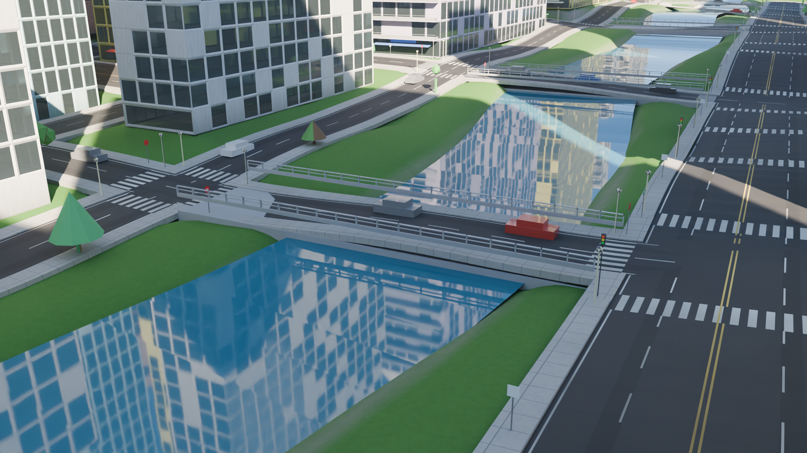

**Castle dungeon, seed 7 - from the lower level looking up the staircase through the floor of the level above:**
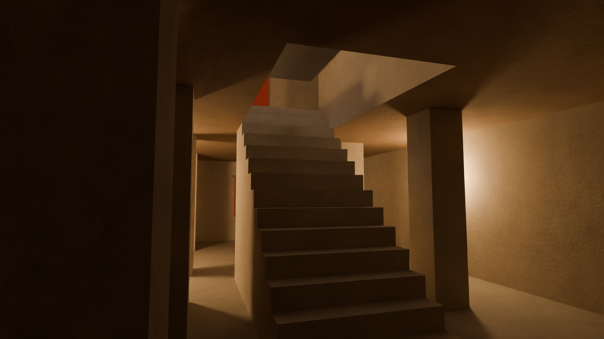

**Kleinstadt, seed 4 - the country road leaving the city's east edge past the village into the forest ring:**
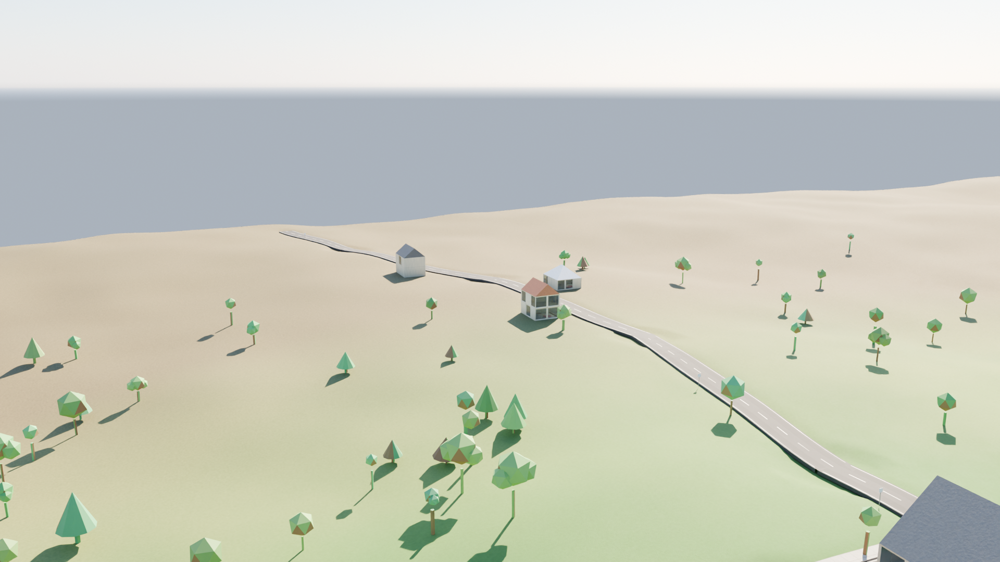

**The exported GLB's hierarchy (Godot naming):**
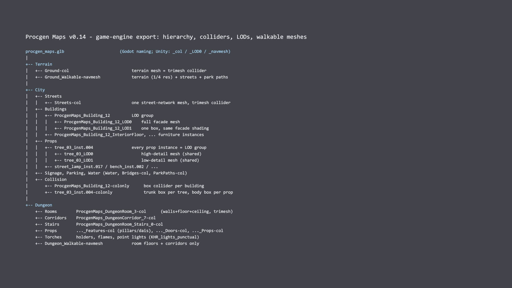

---

## v0.13.0 — Night windows that read as homes, balconies and shops, parks, a river with bridges

The visuals release. Every change here is in the planning half first and
pinned by pure-Python tests (`tests/test_city_visuals.py`), the meshes
follow; `pytest` (217 tests), the headless smoke test and the 50-seed
fuzz validator stay green with the new rules included.

**Night windows.** v0.10's night was every carved pane glowing the same
warm color, which with the frequency-driven window pattern made a
random checkerboard. Now the lighting is planned per floor and per face:
a floor is *dark*, a *band* (an office floor lit wall to wall, cool
fluorescent) or *mixed* (apartments of 2-3 neighbouring bays that are
lit or dark together, mostly warm, a few cool); industrial floors glow
dimly or not at all; entrances are always lit. The result goes into two
per-face float attributes on the building mesh
(`procgen_maps_window_lit` / `_warm`) that the one shared window
material reads with Attribute nodes - no extra materials, no per-window
objects. (`plan_floor_lighting` / `window_lighting` in
`generators/city/buildings.py`.)

**Facades and roofs.** Apartment slabs/towers and mixed-use blocks get
balcony ribbons (slab + railing, on the front or front and back, every
floor or every other one); shopfronts, mixed-use and brick commercial
get a sloped awning and a sign board over the entrance, in one of six
colors picked per building through Object Info > Random. Townhouses and
cottages sometimes get a hip roof instead of the gable, factory halls
mostly a sawtooth roof with north-light glazing, and flat roofs of six
floors and more a water tank and/or an antenna mast in a corner. All of
it is plain boxes added to the building's own bmesh (no operator calls)
or two new instanced props, so the cost is small (OPTIMIZATION.md).

**Parks and plazas.** Park blocks were a fountain and a few trees on raw
grass. Now each one is either a park with a cross of paved paths through
the centre, benches facing the paths, a lamp at two corners and trees
kept off the paving, or (30% of the smaller ones) a paved plaza with
benches and trees along its rim. The paving is one mesh in the sidewalk
material, chunked to follow the ground, and the validator checks that
no tree stands on a path.

**River.** One meandering river runs north-south through the widest
column of the middle third of the street grid. The cells in that column
get no lots but keep their streets, so the river is always flanked by a
street on each side and never touches a building; every second cross
street in the column is kept and becomes a bridge (deck slab, railings,
a pier into the riverbed), the others stop at the banks, and the street
graph stays one component by construction. The terrain is sunk 2.6 m
under the water with the bank as the blend, the water surface follows
the heightfield 1.2 m down. Props and signs keep off the water and the
banks (lamps and cars may stand on a bridge), and `validate_city_plan`
now has `building_in_water`, `prop_in_water`, `sign_in_water` and
`river_without_bridge` rules - 0 issues over the fuzz set. A **River**
toggle in the panel turns it off (`preset.water = "none"` gives exactly
the v0.12 layout). A lake option did not make it.

**The lip.** The v0.12 renders had a dark step along the outside of
every sidewalk: the terrain was sunk 0.5 m under the whole corridor,
sidewalks included, and climbed back over 2.5 m - a trench beside every
curb. The bed is now 0.7 m under the asphalt, rises to 0.2 m across the
sidewalk and blends out over 1.5 m (`terrain.corridor_profile`), the
sidewalk's outer edge has a 0.6 m skirt down into the ground, and road
chunks are 3 m instead of 6 m so a strip hugs the ground more closely.
Remaining: a handful of 1-2 cm terrain-through-asphalt vertices in the
Metropole seed 12 scene check (the asphalt itself, not the sidewalk; the
pure validator reports 0).

**Before/after - Kleinstadt, seed 4, night, the same kind of close-up (v0.12.0 left: every pane the same warm glow; v0.13.0 right: lit and dark apartments, an office band, dark floors, balconies, a rooftop tank):**
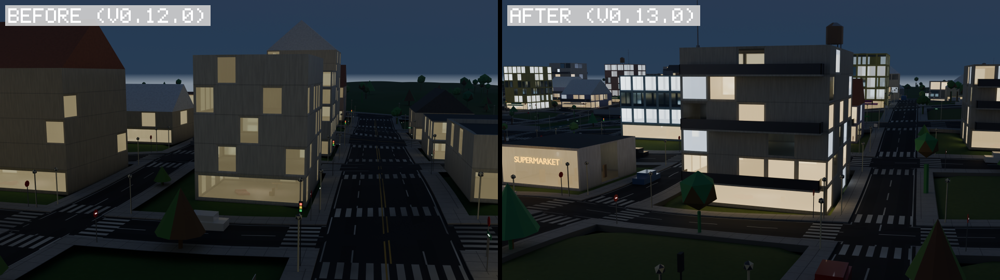

**Metropole, seed 12 - the river between two bank streets, a bridge with railings and pier, sloped banks:**
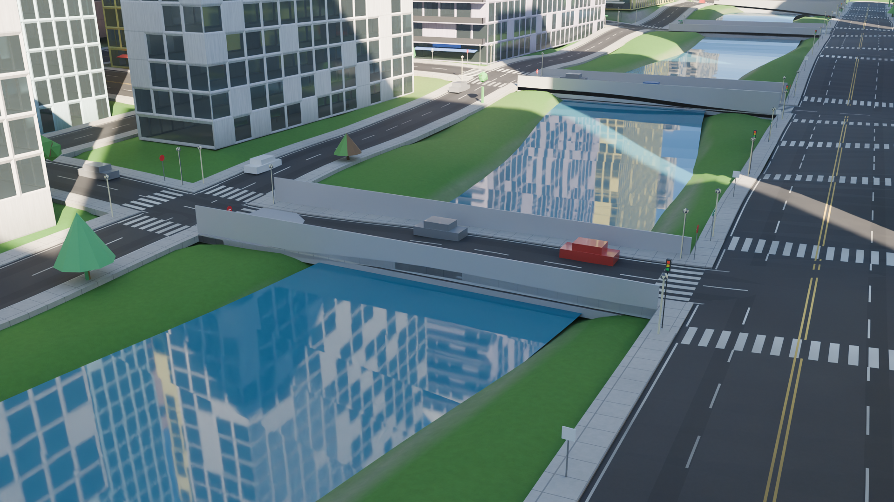

**Kleinstadt, seed 4 - a park block: path cross, fountain, benches, lamps, trees off the paving:**
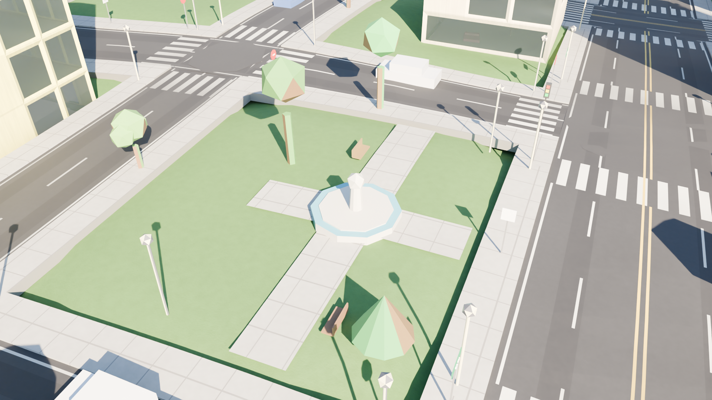

**Kleinstadt, seed 4 - street level: a shopfront with awning and sign board, the sidewalk meeting the ground without the trench:**
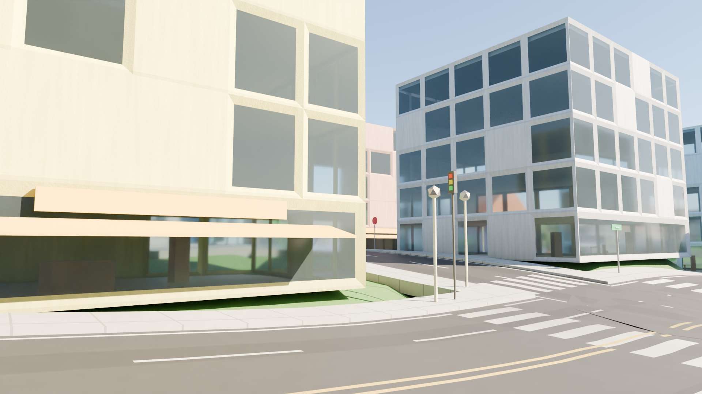

---

## v0.12.0 — Terrain stays under the roads, closed sidewalk corners, one street object

**The bug first.** Every v0.11.0 render had green terrain blotches
poking through the asphalt at crossings and along the roads (look at the
left half of the v0.11.0 intersection image). Cause: streets sample the
*continuous* heightfield at their own vertices, while the terrain mesh
interpolates linearly between grid vertices ~2 m apart - wherever the
ground curves, the mesh sits up to 0.8 m (Kleinstadt) / 1.1 m (Metropole)
above the planar road chunk between two samples. Measured with a new
check (`validation.terrain_above_roads`: one BVH of all street geometry,
a ray straight down from above every terrain vertex, a hit *below* the
vertex is a poke-through): **3,509 terrain vertices above the road in
Kleinstadt seed 4, 9,165 in Metropole seed 12, 560 in Dorf seed 7.**

The fix is in the terrain, not in lifting the roads: after the building
pads are flattened in, the terrain mesh is sunk 0.5 m below the
heightfield under every street footprint (asphalt plus both sidewalks,
plus a disc around every node that reaches the outer corner of the
crossing), blended back to the raw ground over 2.5 m
(`terrain.lower_terrain_under_corridors`). The road bed wins over a
neighbouring building pad's blend, which used to lift the ground back up
under the sidewalk. Road strips are chopped into 6 m instead of 12 m
chunks so they follow the ground more closely. **After: 0 vertices above
the road in Kleinstadt 4 / Dorf 7 / Industrial 3 / Metropole 42, 5 of
171k in Metropole 12 (worst 2.4 cm, inside the curb).** The check runs
in Validate Map and the smoke test.

**Sidewalk corners.** Every strip's sidewalk stopped a fan radius plus a
sidewalk width short of the node and nothing was built in between: each
90-degree corner lost a 2 x 2 m square of pavement (grass between the
two curbs), the top of every T-junction lost a 2 x trim long stretch, and
the outside of a bend had no pavement at all. `corner_sidewalk_paths`
(pure Python, unit-tested) now builds the missing pieces per node:
strip end -> asphalt corner -> strip end for a convex wedge, straight
across for a 180-degree wedge, an arc hugging the asphalt fan around the
outside of a bend. Bends get an asphalt fan too.

**One street object.** The whole network - every strip, every fan, every
corner piece - is now one mesh object (`ProcgenMaps_Street_Network`)
instead of one object per edge and per intersection (714 fewer objects
in a Metropole, 640 fewer in a Kleinstadt). The asphalt shader's road
width and lane count moved from object custom properties to per-face
float attributes (`procgen_maps_road_width` / `procgen_maps_road_lanes`,
read by the Attribute node in GEOMETRY mode), so markings are unchanged.
Generate City drives the window manager's progress cursor between
stages. Timings and counts for all four presets are in OPTIMIZATION.md;
the Metropole stays at ~5 s - the sub-4 s target needs the per-block
building builder, which did not fit this round.

**Before/after - Kleinstadt, seed 4, the same crossing as the v0.11.0 image (v0.11.0 left, v0.12.0 right): no more ground through the asphalt, and the sidewalk runs around every corner:**
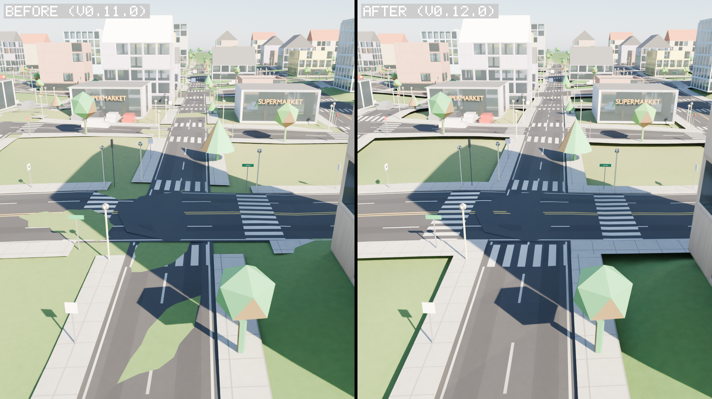

**Metropole, seed 12, low angle - roads on undulating ground, no terrain through them:**
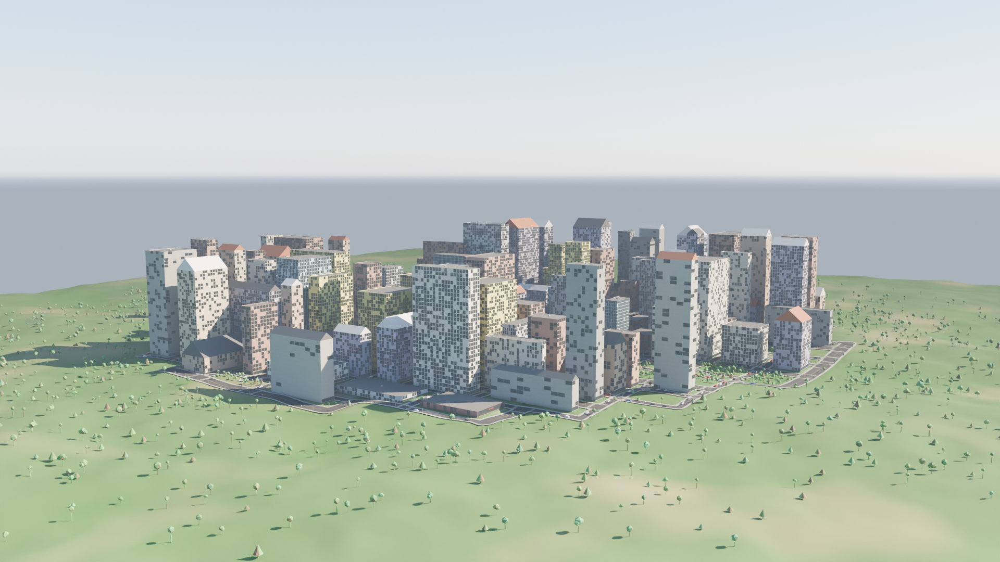

---

## v0.11.0 — Correctness audit: nothing on the asphalt, nothing left behind

A robustness release, not a visual one: the goal was a generator whose
output is provably clean for any preset and seed, and the tooling to keep
it that way. The new pure-Python validator (`procgen_maps/validation.py`)
checks a planned city for buildings overlapping each other or the road
surface, props and signs standing inside a building or on the asphalt,
props overlapping, parking lots across a road, and a street graph that is
not one connected network; inside Blender it adds floating/buried objects
against the terrain and orphan datablocks. A new **Validate Map** button
runs it on the current scene. The planning half of `generate_city` is now
its own function (`plan_city`), so the fuzz test runs the full pipeline
over 50 seeds x 4 presets without Blender.

**What the audit found (12 seeds x 4 presets, 84k props, 23k signs,
3.6k buildings):** 12,057 props on the asphalt, 479 prop pairs
overlapping, 139 signs on the asphalt, 41 parking lots running into the
road. Buildings, street connectivity and determinism were already clean.
Causes, each now fixed with a regression test:

- Street lamps and trees were placed from `t = 0` to `t = 1` along every
  edge - including both end nodes - so a lamp stood in the middle of every
  crossing street (270-350 per city). They now start past the crossing
  street's half width plus sidewalk, the same trim the sidewalk itself
  uses.
- Traffic lights were offset sideways from the node only, which walks
  along the crossing arterial's centerline: every signaled intersection
  had a pole in the middle of the road. They now stand on the corner.
- The collision grid checked a tree's unscaled footprint while forest
  trees are scaled up to 1.6x, so big trees overlapped.
- Park trees and shop signs were scattered over the raw block rectangle,
  which on grid presets overlaps the arterials by up to 1.7 m; they now
  use the same road-setback solver as the buildings. Forest-ring trees
  avoid the street stubs that run out past the city circle.
- Supermarket parking lots ran to the block's front edge - asphalt on
  asphalt; the lot is pulled back a sidewalk's width from the road, and
  street props keep out of the lot.
- Parked cars were spaced over the whole edge, so the first one sat in
  the intersection fan / zebra crossing; they use the same trimmed range.
- Intersection fans were exactly coplanar with the road strips they
  cover (z-fighting); they sit 1 cm higher now.

**After: 0 issues over 50 seeds x 4 presets (354k props, 105k signs, 15k
buildings), every plan bit-identical when re-planned.**

**Scene-side (headless Blender, all 4 presets, terrain + city + dungeon
regenerated three times with changing seeds):** no datablock growth and
no orphans - but regenerating only the city on an existing terrain left
the previous city's flattened building pads *and the previous seed's
heights* in the terrain mesh: 255k-704k of the terrain's vertices
disagreed with a fresh terrain + city. The terrain is now reset to the
heightmap before the new pads are flattened in (0 stale vertices), and
the smoke test pins it along with "regenerate twice does not grow any
datablock" and "no `PROCGEN_*` class survives unregister". Edge seeds
(0, 2^31-1), a city without terrain and terrain without a city are
covered by tests as well.

**Before/after - Kleinstadt, seed 4, the same arterial/local crossing (v0.10.0 left, v0.11.0 right): the lamp in the middle of the arterial, the tree in the crosswalk and the car parked across the junction are gone - sidewalk props and kerbside cars start past the corner, the traffic light stands on it:**
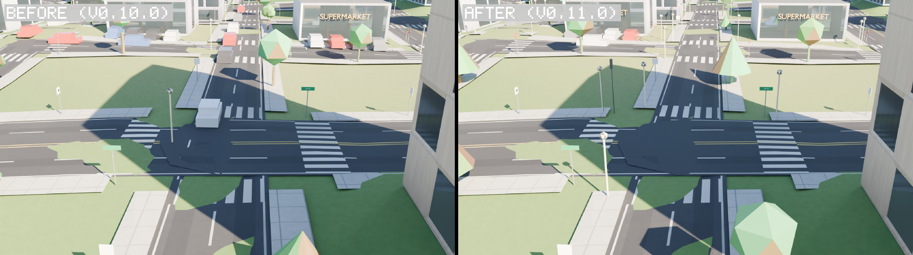

**Metropole, seed 12, low angle - the forest ring now stops at the rim streets instead of growing on them:**
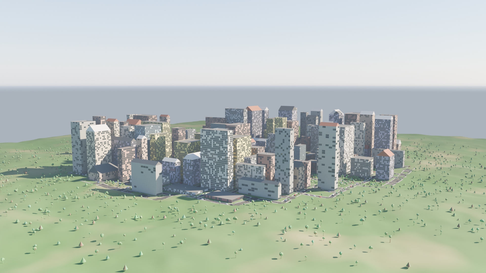

**Industrial, seed 3 - overview; Validate Map reports "OK - no issues" for it:**
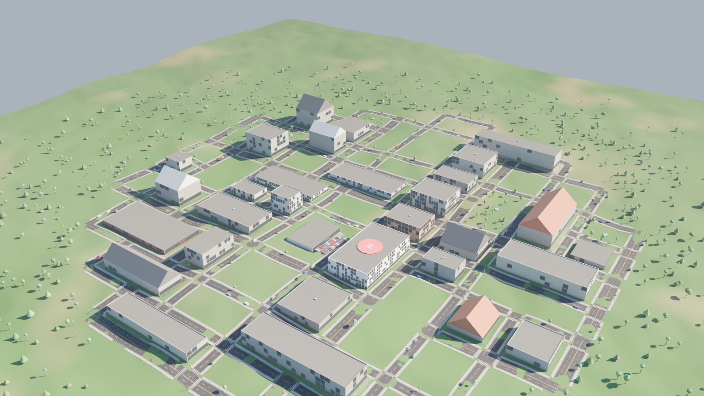

---

## v0.10.0 — CI fixed, 3.4x faster Metropole, and a city that finally looks like one

Three goals for this round, in order: make CI green, make generation
faster, make the renders clearly better than v0.9.0 - and the three turned
out to be the same story, because profiling and headless rendering kept
exposing bugs that had been hiding in plain sight.

**CI.** `pytest` failed at collection on both runners because the bare
`pytest` CLI never puts the repo root on `sys.path` (a root `conftest.py`
fixes that), and `blender-smoke` died with SIGABRT because the showcase
render used EEVEE, which needs a GPU/OpenGL context even in
`--background`. Both renders now run Cycles on the CPU (denoised), which
also made every render in this entry possible on a machine whose GPU was
busy. Running the smoke test on Blender 5.2 surfaced two API breaks too:
the sky model enum lost `NISHITA` and the USD exporter lost
`export_textures`; both are now detected via RNA. The workflow installs
Blender's X11 libs, caches the download, passes `--python-exit-code 1`
and is a real gate.

**Determinism.** The same seed never produced the same city twice: window
carving drew from the global `random`, rooftop/furniture seeds used
`hash((block_id, "detail"))` (str hashing is randomized per process), and
the per-floor "new faces" set was iterated in memory-address order. All
three are fixed and pinned by tests; an order-insensitive fingerprint of
every generated vertex/face/object is now identical run to run, which is
what made the optimizations below verifiable.

**Speed (see OPTIMIZATION.md for the full profile).** Metropole took
26.9 s, 24 s of which were 114k single-face `bmesh.ops.inset_individual`
calls - one per window bay. Chasing that revealed that the column
subdivision had never worked: `subdivide_edges(use_grid_fill)` on two
edges of a quad doesn't split it, it returned the *neighbouring* faces that
gained a vertex - the base, the roof cap and the unsplit side - as the
"columns". So the ground floor got one window per side, the roof got
random nested insets tagged with the *window glass* material (that's why
every flat roof in v0.8/v0.9 rendered as dark blue glass), and upper
floors only had columns because the roof's fragmented boundary happened
to extrude into pitch-wide strips. Columns are now cut with
`bmesh.utils.edge_split`/`face_split` and all windows of a floor go through
one inset call. Together with a numpy terrain build, a bit-identical
scalar fast path for `fbm`, vectorized footprint flattening and dict
lookups in the night-mode toggle: Metropole 26.9 s -> 7.7 s, Kleinstadt
2.5 s -> 1.6 s, Dorf 1.2 s -> 1.0 s, night-mode toggle 1.3 s -> 0.4 s.

**Layout.** Measuring building/road clearance for the sidewalk work found
that the median Metropole wall stood 3.7 m *inside* the road, and that the
raster presets' street graph had one isolated 2-node component per
segment (823 of 823) - zero intersections, so no fans, crosswalks, stop
signs or traffic lights ever applied there, and roads ended in mid-air.
"Raster" mode is now an irregular street grid (uneven spacing, circular
outline, 22% of lots merged into larger blocks) whose graph is one
connected component with ~130 intersections and lots inset from every
line by that street's half width plus the sidewalk. Grid-layout buildings
get the same clearance from a tested setback solver.

**Look.** Roads were untextured white planes; the terrain shader mapped
absolute height onto a grass-dirt-snow ramp, so a city at 8-16 m sat on
"frost"; and the physical sky at exposure 0 blew everything out. Now:
asphalt with dashed/double center lines, lane dividers, edge lines, zebra
crossings at intersections, paint wear and tire darkening, painted from
meter-scaled UVs by one shared shader; raised curbs and paving-jointed
sidewalks on every street; parked cars in the kerbside lane instead of on
the grass; a slope/height-driven grass-rock ground with dry patches; a
thinning forest ring outside the city; facades with ground grime, rain
streaks, floor-slab lines and roughness variation; parapet-walled flat
roofs and tiled gables with their own roof material; per-instance tree
and car color variation; AgX with a medium-high-contrast look and
per-preset exposure; a lifted, hazier sky dome; and a shared
aerial-perspective node group that fades every material toward the sky
color with distance (warm for the new Golden Hour preset). The Lighting
panel gained presets (Afternoon/Midday/Golden Hour/Soft Overcast), haze,
and day/night exposure; the main panel a Generate All button and a
randomize-seed dice. Dungeons: pillar grids in large halls, a dais in the
boss room, stone grain and bump.

**Before/after - Metropole, seed 12, the same supermarket block (v0.9.0 render vs. this version's close-up):**
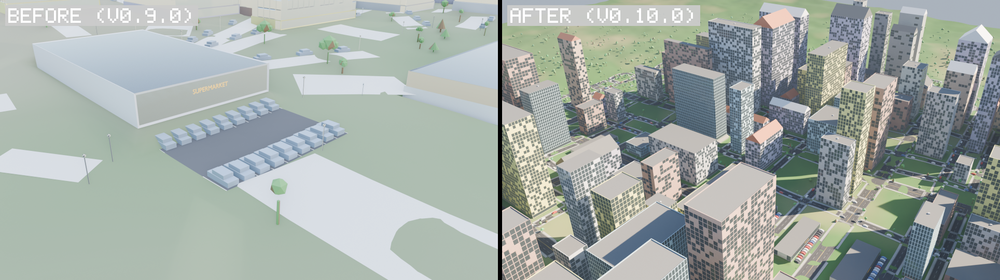

**Metropole, seed 12 - towers with real window columns on every floor, parapets, crosswalks, lane markings, kerbside cars:**
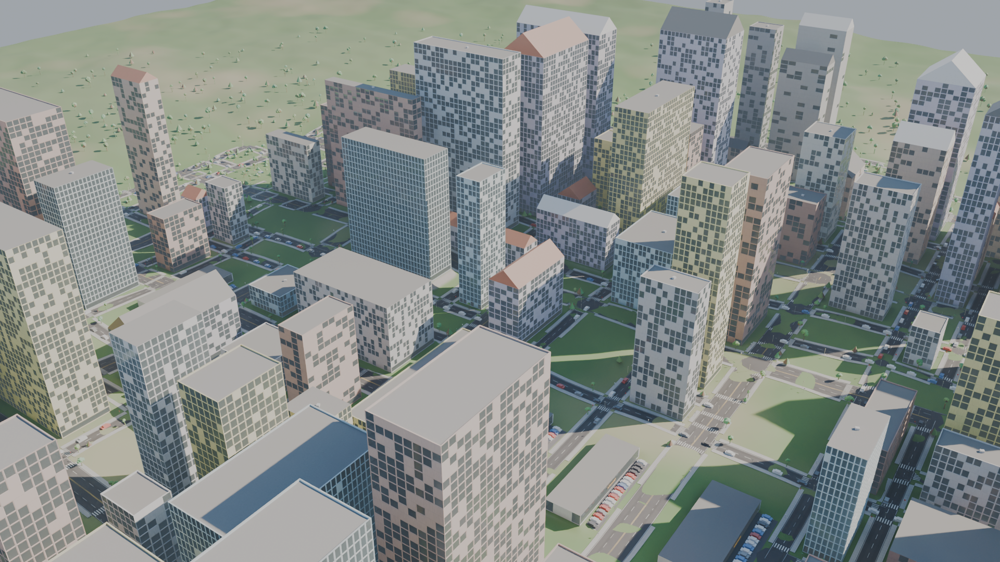

**Metropole, seed 12 - skyline at a low angle, with the forest ring and aerial perspective:**
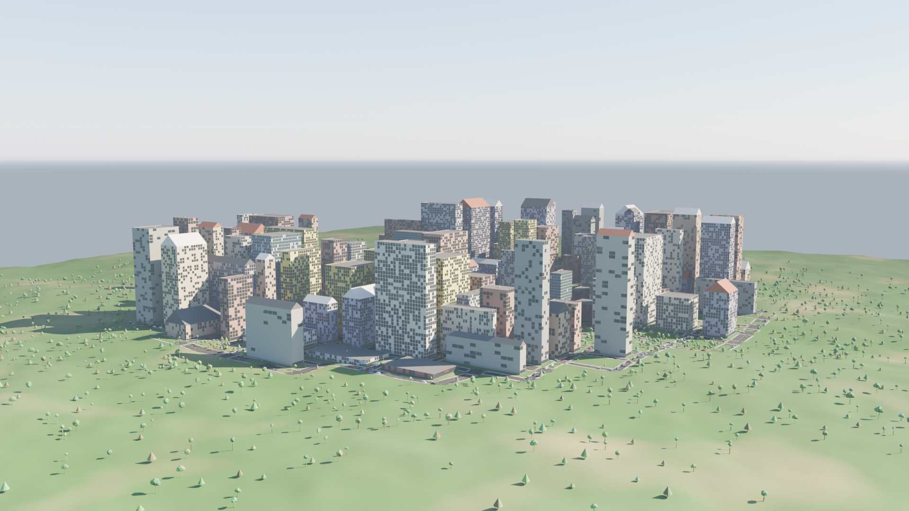

**Kleinstadt, seed 4 - overview: connected grid, sidewalks, tiled roofs, grass/forest edge:**
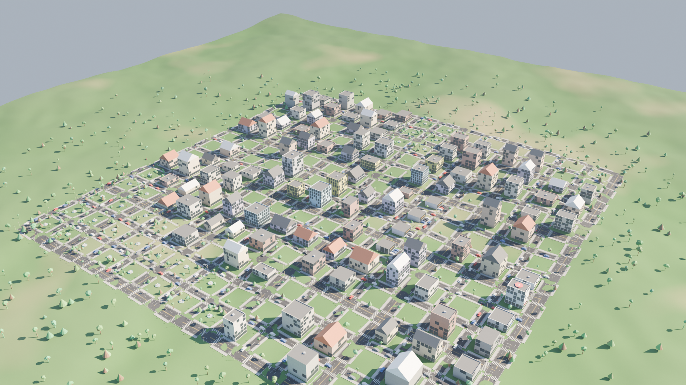

**Kleinstadt, seed 4 - Golden Hour preset (warm haze, long shadows):**
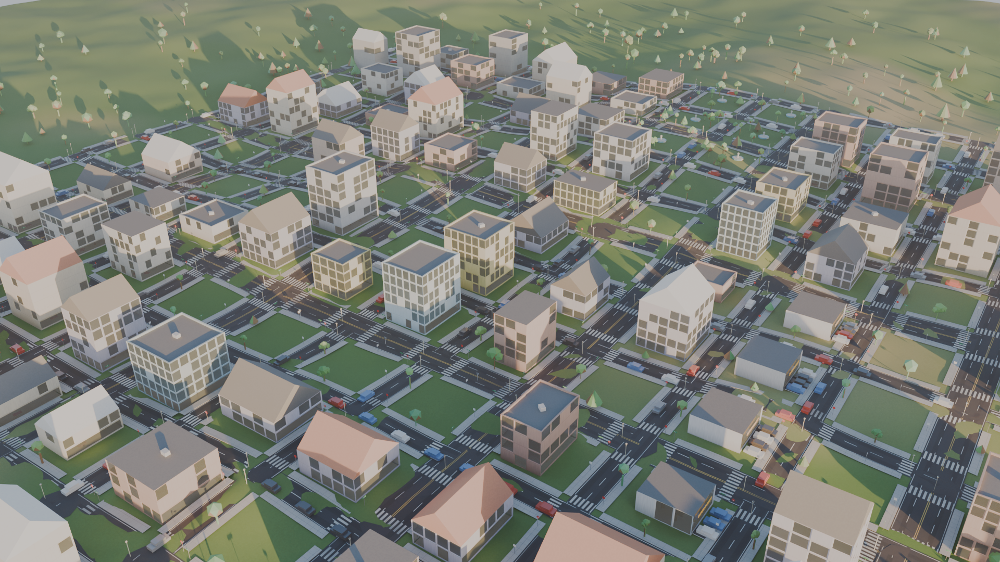

**Kleinstadt, seed 4 - night mode: warm pulsing windows, lamp pools on the asphalt:**
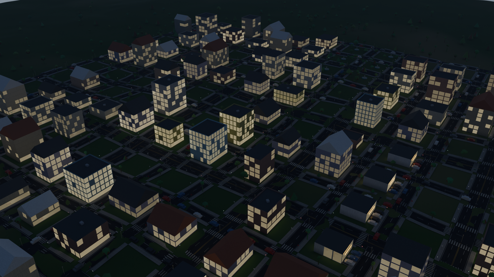

**Dungeon, seed 7 - the boss hall with its pillar grid and dais, lit only by the doorway torches:**
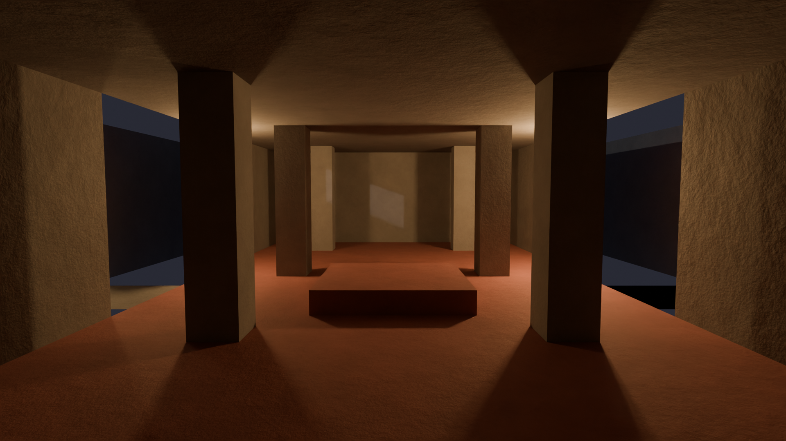

**Video - Kleinstadt, seed 4, a 4 s Cycles-CPU camera sweep (960x540, 24 fps, H.264; kept short so it could render on the CPU alongside the stills - the same `flyover` setup renders longer/larger clips by changing the frame count and resolution):**
[docs/progression/v0.10.0-kleinstadt-flyover.mp4](docs/progression/v0.10.0-kleinstadt-flyover.mp4)

---

## v0.9.0 — Dungeon interiors, park/parking vibrancy, driver-based animation

Scoped from the user's list after v0.8.1 shipped: "improve the dungeon, make
animation and better tree / terrain and fountain, park, parking spaces, less
cars to make it more vibrant and more."

**Dungeon rooms were open-topped, unmaterialed shells with corridors
dead-ending against solid walls.** `generators/dungeon.py` built only a
floor + 4 flat walls per room - no ceiling, no doorway where a corridor
actually connects, no materials, no lighting. Rewritten so every corridor
segment's start-or-end point is exactly some room's own `.center` (true by
construction of `connect()`), which means the wall a corridor exits
through - and where along it - can be read directly off that segment's own
direction, no geometric intersection test needed. `_find_doorways` +
`_wall_segments_with_gaps` use this to cut real gaps in the walls; rooms
now get floor + ceiling + 4 walls-with-doorways across 3 material slots
(new `materials/dungeon_mat.py`), the largest room is tinted as the "boss"
room and the smallest as the "start" room, and a torch (bracket mesh +
warm point light) lights every doorway.

**Tree canopies were only ever a plain cone or a plain sphere.** Added a
third "cluster" shape - 3 overlapping icospheres at different sizes/offsets
- cycled across the 12 tree variants alongside the existing two, so a
street doesn't read as identical balls-on-sticks.

**Parks had trees and benches but no centerpiece.** Large park blocks
(>= 400 sqm) now get a fountain (stone base, a tinted water ring, a
central pillar) placed before the tree/bench scatter, so those naturally
avoid overlapping it via the same collision grid every other prop uses.

**Supermarkets had no parking, and every local street was lined bumper to
bumper with cars.** Supermarket footprint shrink dropped from 0.92 to 0.55
- shrinking a block-centered footprint frees an equal margin on all 4
sides, and the entrance-facing margin now becomes a real parking lot (new
`generators/city/parking.py`): a terrain-following asphalt pad, painted
stall-divider lines, and a grid of parked cars in one or two rows with a
drive aisle. Roadside car spacing widened from 6m to 10m so cars read as
parked, not welded together - parking lots pick up the slack for a livelier
feel overall.

**Static cities felt static.** Added lightweight, keyframe-free animation
via Blender's driver expressions (`sin(frame*freq+phase)*amplitude` -
`frame` is available directly in a scripted driver's expression namespace,
no variable needed, confirmed by direct test): every tree Empty gets a
subtle back-and-forth sway on its own X/Y rotation, frequency/phase/
amplitude seeded from its own location so a row of trees doesn't sway in
lockstep. Lit building windows (`materials/city_mat.py`) get a slow
sine-driven emission pulse layered on top of the existing night-mode
emission strength, phased per-building using each building's own
`procgen_maps_tint` attribute (already computed for facade-color
variation) - one shared material, one driver, no per-window objects
needed, verified by checking the driven node's evaluated value and the
actual rendered pixel brightness both change across frames.

**Kleinstadt/Metropole, various seeds — a fully enclosed dungeon room with a doorway cut into the wall, a torch lighting it, and the boss room's warm floor tint:**
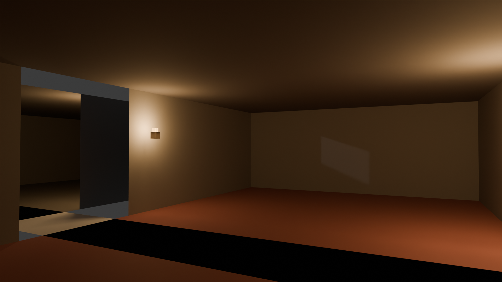

**Top-down check of a full BSP layout — every room now has a ceiling and real doorway gaps instead of solid walls:**
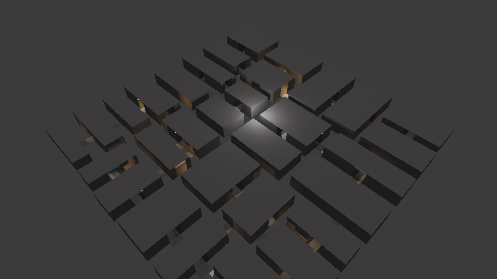

**Metropole, seed 12 — a supermarket's new parking lot (two rows, painted stalls, drive aisle) plus a cluster-canopy tree in the background:**
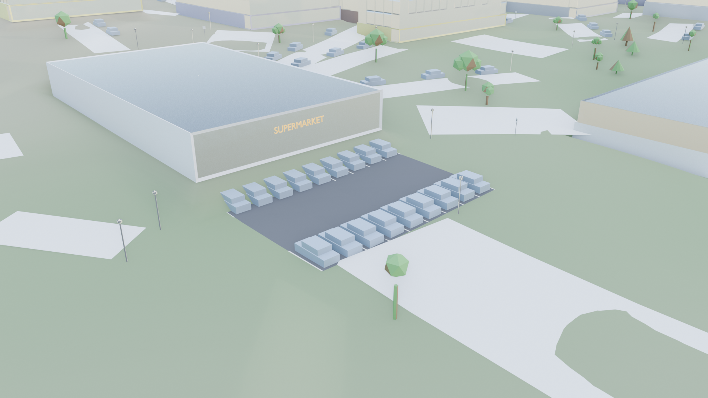

**Metropole, seed 12 — the new park fountain centerpiece:**
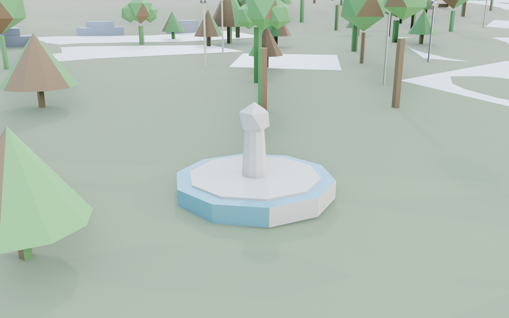

**Kleinstadt, seed 4 — the new 3-lobe "cluster" tree canopy shape, close up:**
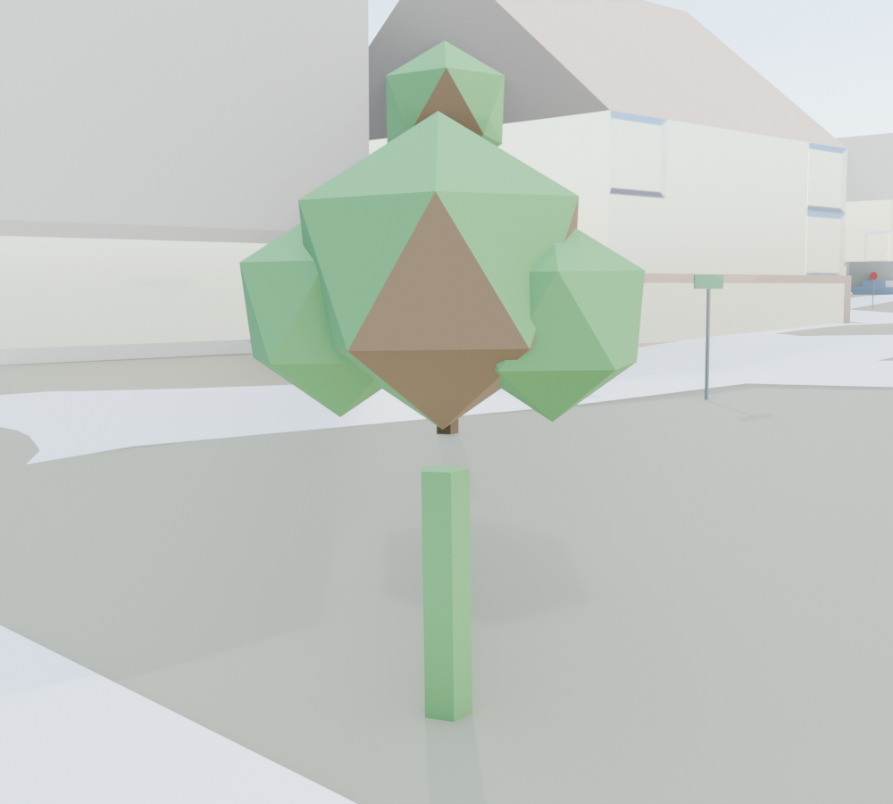

---

## v0.8.1 — Street/terrain follow-up, a real interior-view tool, higher render quality

Direct follow-up to v0.8.0's bug list, scoped narrowly per request.

**Streets still clipped into terrain on long runs.** v0.8.0 fixed buildings
sitting flush on the ground; streets had the same root cause in a
different shape - `_build_road_strip` built exactly one flat quad per
edge regardless of length, sampling terrain height only at its 4 corners.
A 100m+ arterial can have real undulation between those two endpoints
that never gets sampled, so the strip either clips into a hill or leaves
a gap over a dip along its length even though both ends match the ground
exactly. Fixed by chopping any edge longer than 12m into chunks, each
sampling its own corners - the same reason the terrain mesh itself is a
fine grid and not one giant quad.

**"How do I render a building's interior?"** - added a real one-click
answer: a **Render Interior View** button (targets the selected building,
or the first one found) that frames a camera at the entrance and renders
through the glass. Getting this to actually show something took two real
fixes: an occlusion-safe camera placement (a straight-line raycast backs
the camera off in 1m steps until the entrance isn't blocked by a
neighboring building across a narrow street - block gaps can be under the
naive 8m default), and, more fundamentally, discovering that **EEVEE
Next's screen-space transmission cannot show a room whose only
visibility is through the very window being looked through** - screen-space
methods only reflect/refract data already visible somewhere on screen,
and an interior with no other line of sight has nothing else to draw
from, so EEVEE rendered a flat, empty-looking wall no matter how the
camera was aimed. Confirmed by rendering the identical camera and scene
in Cycles (true ray tracing) - the interior light and furniture read
clearly. The new button renders with Cycles specifically for this
reason; slower (roughly a minute or two vs. seconds), but it's the only
engine that actually delivers what the feature promises.

**4K quality, a second pass.** Beyond the resolution/sample bump already
in v0.8.0, enabled ambient occlusion (`use_gtao`, quality 1.0) and pushed
shadow ray/step counts and diffuse GI bounces up - all one-off costs
worth paying for a hero render, not the live viewport.

**Kleinstadt, seed 7 — a long arterial now follows terrain the whole way, not just at its endpoints:**
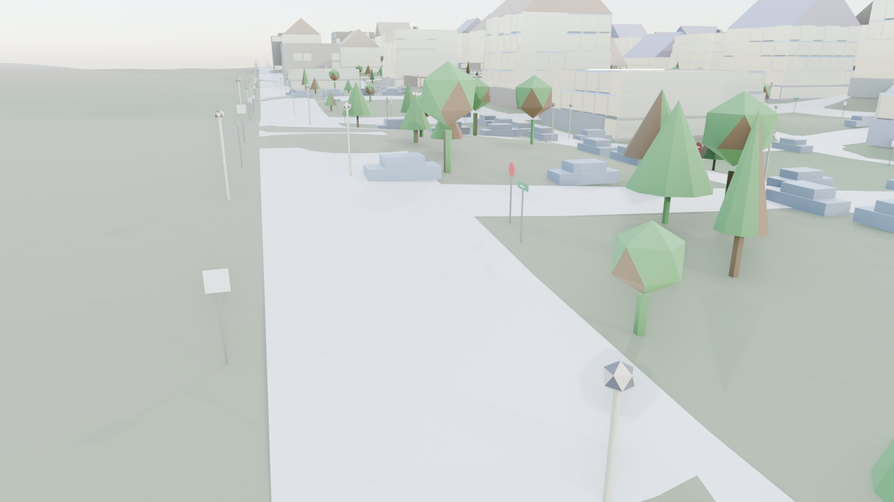

**Kleinstadt, seed 7 — Cycles interior view: the ground-floor light and room structure visible through the entrance glass, where EEVEE showed nothing:**
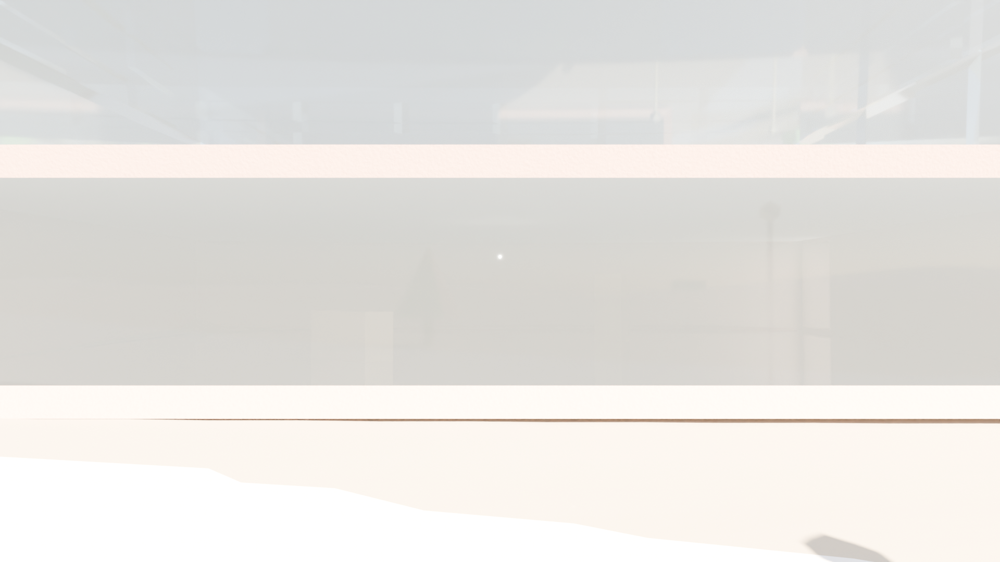

**Live Blender session — new "Render Interior View (Cycles)" button, building selected:**
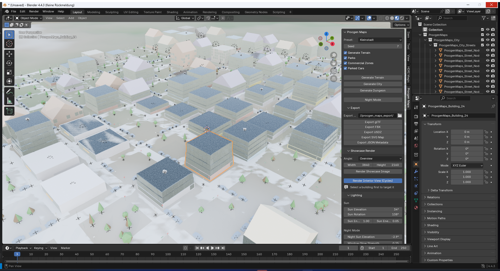

---

## v0.8.0 — Bugfix round: terrain grounding, signage clutter/traffic lights, raytraced glass, 4K defaults

A direct user bug report ("terrain still bugging and overlapping, many signs
not on the street, cars not aligned, too many street signs and no traffic
lights, no glass for windows/no interior visible") drove this round. Root
causes, investigated with a live diagnostic pipeline (headless renders of a
worst-case sloped building, a top-down car/street check, and a raytracing
on/off comparison) before touching any code:

- **Terrain "overlapping"**: the visible terrain mesh was far too coarse
  (256x256 over a 1000m world, ~3.9m/cell) relative to the noise detail
  every building/street/prop/sign samples *exactly* via
  `sample_world_height` - the coarse mesh simply couldn't agree with the
  precise value everything else used, so buildings could clip into or
  float above the ground on any real slope (measured up to 8m of height
  variance under one building's own footprint). Fixed two ways:
  terrain resolution doubled to 512, noise gentled (broader scale, one
  fewer octave, roughly half the old amplitude) so the mesh and the
  sampled field agree far better everywhere; and a new
  `generators/terrain.py:flatten_terrain_for_footprints`, called from
  `generate_city` right after building placement, locally reshapes the
  ground mesh under every building footprint to match that building's
  own already-chosen base height, with a smooth blend at the edges - a
  building's foundation is now guaranteed flush with the visible ground,
  not just statistically likely to be close.
- **Too many stop signs, no traffic lights**: `signage.py`'s stop-sign
  rule now exempts the one pair of incident edges most nearly opposite
  each other at any intersection (`_find_through_pair`) - the priority
  "through" route, mirroring how a real minor junction works - roughly
  halving stop-sign counts at ordinary 4-way intersections. Any
  intersection with 2+ arterial approaches gets a new decorative
  red/yellow/green traffic light instead of nothing (previously an
  accepted gap). Speed-limit repeater spacing was also widened.
- **Signs not on the street**: the stop-sign/street-name setback distance
  was never clamped against the incident edge's own length - on a short
  block-corner edge it could push the sign's position past the far
  endpoint entirely. Now capped at 40% of the edge's own length.
- **No glass, no visible interiors**: window transmission
  (`materials/city_mat.py`'s glass material) only actually renders as
  see-through with EEVEE Next's raytracing enabled - which was previously
  only ever turned on inside the one-off Showcase Render button, never
  for the main generate flow or the live viewport. Both `Generate
  Terrain` and `Generate City` now enable it by default.
- **4K quality defaults**: Showcase Render resolution default raised to
  3840x2160 at 256 samples (from 1280x800/128).
- Investigated but not a bug: parked-car rotation/offset math checked out
  correct (length axis matches the street direction, offset matches the
  curb-clearance formula exactly) - the "not aligned" impression traces
  back to the same terrain-mismatch root cause above, now much reduced.

**Kleinstadt, seed 7 — 4K hero overview (3840x2160, buildings now flush with the ground):**


**Kleinstadt, seed 7 — a new traffic light at an arterial crossing, POLICE/HOSPITAL/SCHOOL special buildings nearby:**
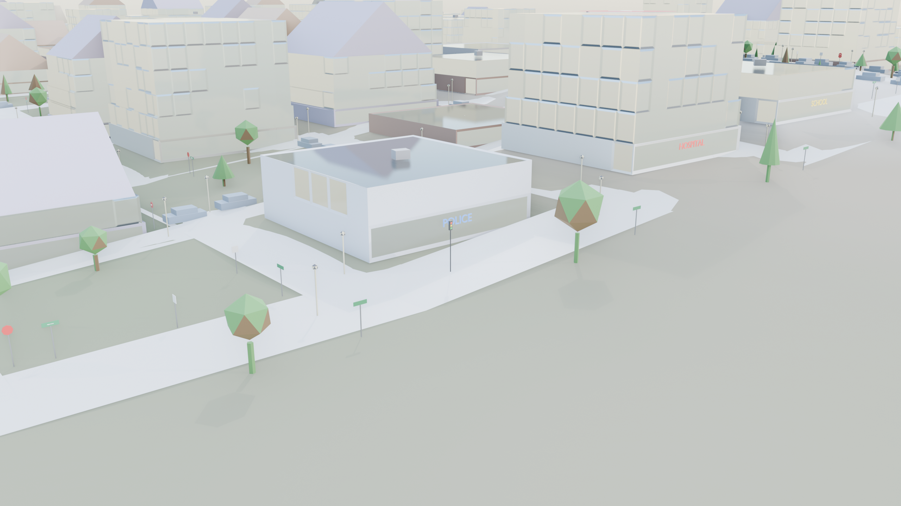

**Live Blender session — Lighting panel + 4K showcase defaults visible, city properly grounded:**
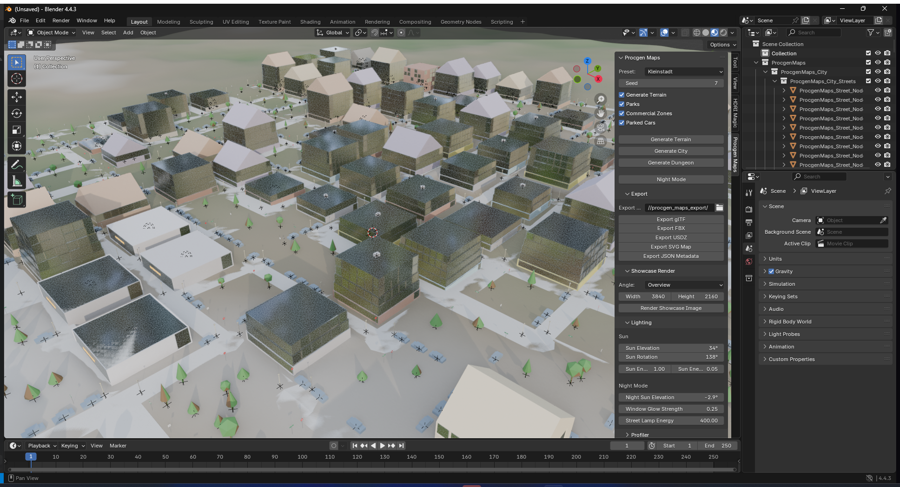

---

## v0.7.0 — Street signage/traffic logic + a Lighting configuration panel

Two features this round. **Street signage** (`generators/city/signage.py`):
deterministic, rule-based sign placement driven by the street graph's own
intersection degree and street_class hierarchy, not a random density
roll. A local approach at any real (3+-way) intersection gets a stop
sign; an all-arterial intersection gets none (no traffic-light feature
exists here - an accepted scope boundary); every street gets speed-limit
repeater signs (50 km/h arterial, 30 km/h local) at a class-dependent
interval; and every arterial approach at a real intersection gets a
street-name sign, one name per edge (a small deterministic word bank) so
both ends agree. All three are bespoke mesh+FONT objects built directly
in the new module (mirroring `special_buildings.py`'s sign-building
idiom), collision-checked against buildings/props/other signs via the
same `SpatialHashGrid` pattern `props.py` uses.

Discovered along the way: raster-mode presets (Metropole, Industrial)
currently produce a street graph where *every* node has degree 1 - no
real intersections at all - because `_raster_street_segments` computes
each block's street-exit point per-neighbor from that neighbor's own
center-line direction, so a block touching 3+ neighbors never gets
coincident exit points to snap into one junction. Stop signs and
street-name signs are therefore grid-mode-only (Kleinstadt, Dorf) for
now; speed-limit signs are unaffected (purely per-edge). Documented in
signage.py's module docstring as a known, pre-existing limitation rather
than silently worked around - fixing the raster topology itself is a
separate, larger change.

**Lighting panel** (`ui/panels.py`): promotes what used to be hardcoded
constants scattered across `operators.py`/`world_mat.py`/`city_mat.py`
(sun elevation/rotation, day/night sun energy, night-mode window glow
strength, street lamp energy) into seven live-tunable Scene properties,
each wired through a `night_mode`-style `update=` callback (no separate
"Apply" button - these are cheap in-place property writes, not a
regenerate). An adversarial review pass (multi-agent) caught two real
gaps before shipping: the Showcase Render operator was still using its
own independent hardcoded sun constants instead of the new panel values
(fixed - `ensure_showcase_sun` now accepts the panel's elevation/rotation,
converted between the Nishita sky's elevation-from-horizon convention and
the Sun light object's zenith-angle convention), and the new
`set_sun_energy`/`set_sun_position` functions could have silently
overwritten an unrelated World's settings if dragged before "Generate
Terrain" was ever clicked (fixed - both now check `world.name` first).

**Kleinstadt, seed 7 — stop signs + a street-name sign at a real intersection (dense with lamps/trees/cars too):**
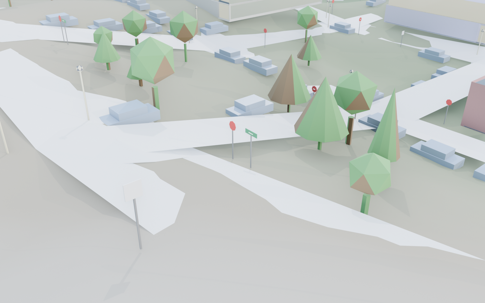

**Kleinstadt, seed 7 — a speed-limit sign along a local street:**
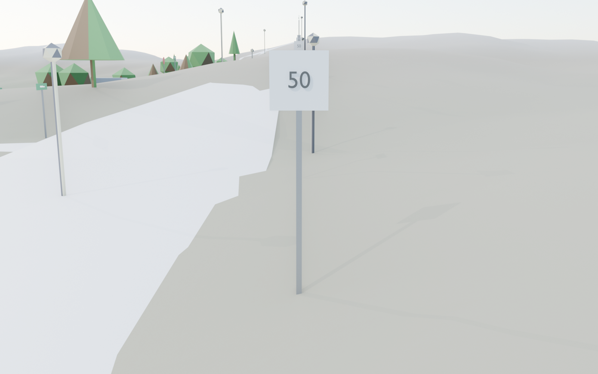

**Live Blender session — new Lighting panel expanded (Sun/Night Mode fields visible):**
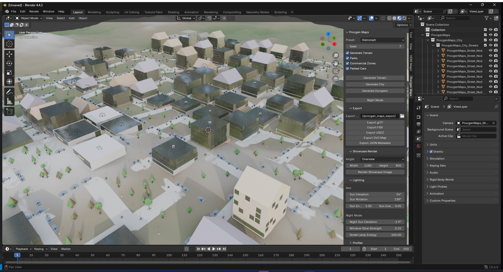

---

## v0.6.0 — Special buildings: supermarket, police station, hospital, fire station, school

Five unique, zone-targeted building types beyond the 12 generic facades,
placed by explicit selection logic (`generators/city/special_buildings.py`)
rather than the random per-block facade pick `buildings.plan_buildings`
uses: each city gets one police station, hospital, fire station and school
(largest available block in an allowed zone), plus a supermarket every ~45
blocks (so bigger cities get more than one). Reuses `buildings.BuildingPlan`/
`FacadeType` directly - each special type is just a `FacadeType` with its
own fixed floor count/height and an extended material_index (12-16 in
`city_mat.py`'s facade color ramp) instead of a randomly rolled one, so the
exact same shell/window/roof/interior mesh construction applies unchanged.
`generate_city` now reserves each special building's block before handing
the rest to `plan_buildings`, so a block never gets both.

Every special building gets an illuminated sign - a real Blender Text
object mounted on the entrance facade, not a texture, so it's readable at
any render distance - plus, for hospitals specifically, a rooftop helipad
(a flat disc + a raised "H" marking). Furniture catalog
(`assets/library.py`) extended with per-type interior sets (hospital beds,
police desks, supermarket shelving/counters, etc.) for the ground-floor
interiors every building already gets.

New pytest coverage in `test_generators.py`: reserved-block/plan bookkeeping
is consistent, special buildings never land on park blocks or reuse a
regular building's block, `min_blocks_required` correctly gates small
cities out of types they're too small for, supermarket count scales with
city size, planning is deterministic for a given seed, and every spec has a
unique material index.

**Kleinstadt, seed 7 — hospital close-up (sign + rooftop helipad), with the neighboring police station and school also in frame:**
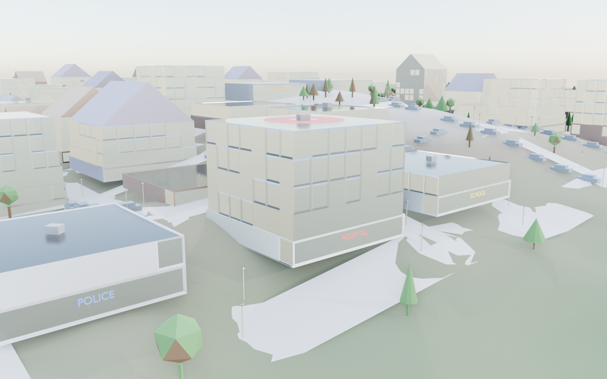

**Kleinstadt, seed 7 — supermarket close-up (two placed in this city, per the every-45-blocks scaling):**
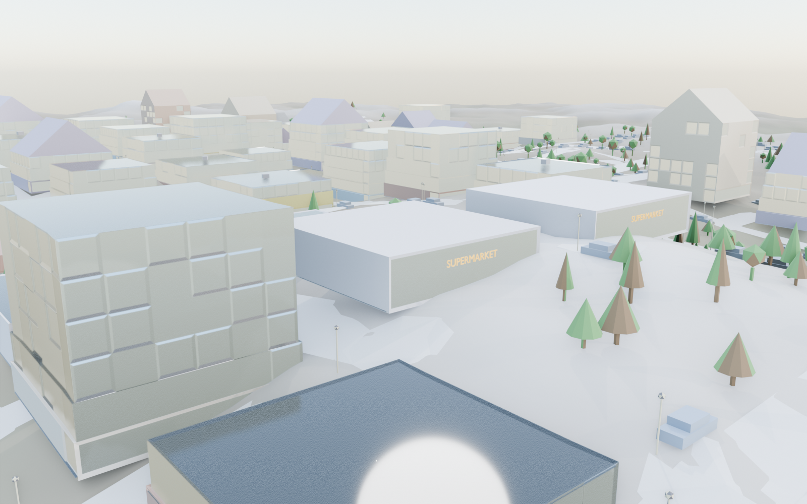

**Kleinstadt, seed 7 — full city overview:**
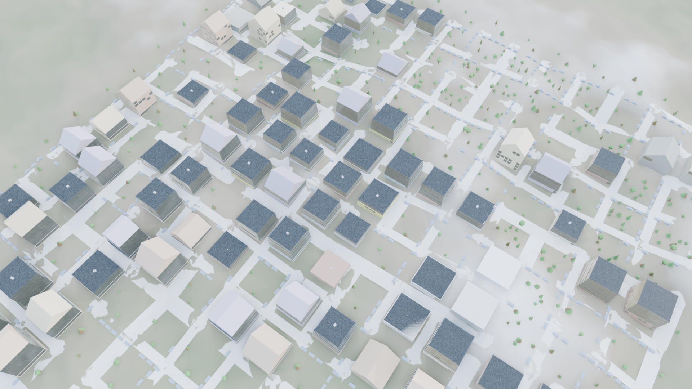

**Live Blender session — actual screenshot, N-panel open:**
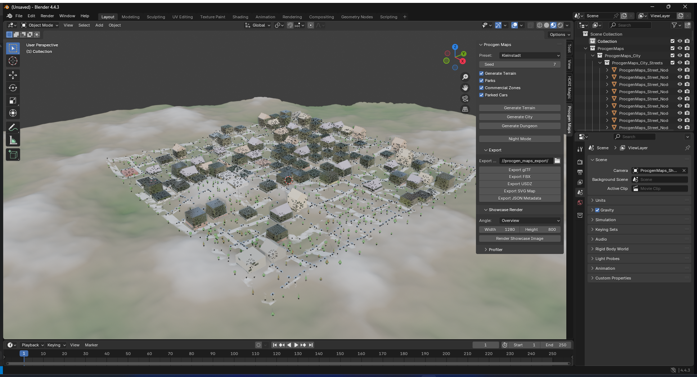

---

## v0.5.0 — New feature: "Render Showcase Image" tool

Every render/screenshot in this document up to now came from a one-off
Python script written by hand each time (bounding-box math, camera
placement, sun setup, EEVEE settings) - none of that lived in the addon
itself. This turns it into a real, reusable feature: a new `rendering/`
subsystem (`framing.py`, pure-Python bounding-box-to-camera-placement math,
fully pytest-covered; `showcase.py`, the bpy build step that creates the
camera/sun and configures+triggers the render) plus a **Render Showcase
Image** button in a new N-panel section, with an angle dropdown (Overview /
Close-up / Low Angle) and a resolution field. One click auto-frames a
camera on whatever's been generated, sets up sun position for day/night,
turns on raytracing for correct glass transmission, and renders straight to
the export directory - no more hand-tuning a script per screenshot. This is
meant to keep improving over future rounds (more angle presets, depth of
field, compositor-based color grading, etc.).

**Kleinstadt, seed 12 — produced by clicking the actual button (well, calling the same operator the button calls):**
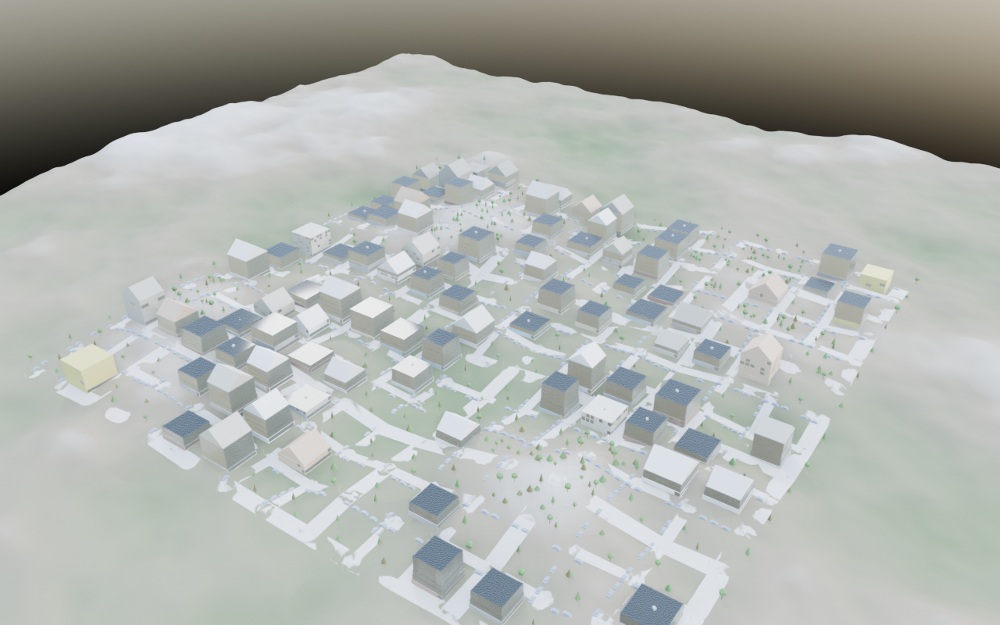

**Live Blender session, N-panel open (Procgen Maps tab visible in the sidebar):**
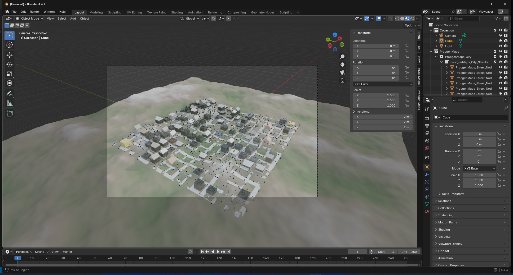

---

## v0.4.0 — Procedural sky + facade/terrain material detail for higher-quality rendering

First rendering-quality pass (materials only - no new generator logic).
Every `generate_terrain` call now sets up a real Nishita procedural sky
world (`materials/world_mat.py`) instead of a flat background color, so
renders get physically-based sky gradient, sun, and ambient lighting for
free; night mode dips the same sky's sun below the horizon rather than
swapping to a separate flat-color night world. The city facade material
mixes in an Object-space noise "grain" (stable per building, not flickering
with world position) on top of the flat per-facade color, plus a matching
Bump for micro-surface detail - and the terrain material got the same
treatment (speckle noise breaking up the flat height-band colors, finer
noise driving its own bump). All purely procedural shading tricks - no
image textures, no extra geometry/subdivision - consistent with the
addon's no-baked-assets approach everywhere else.

**Kleinstadt, seed 8 — rendered, raytracing on:**
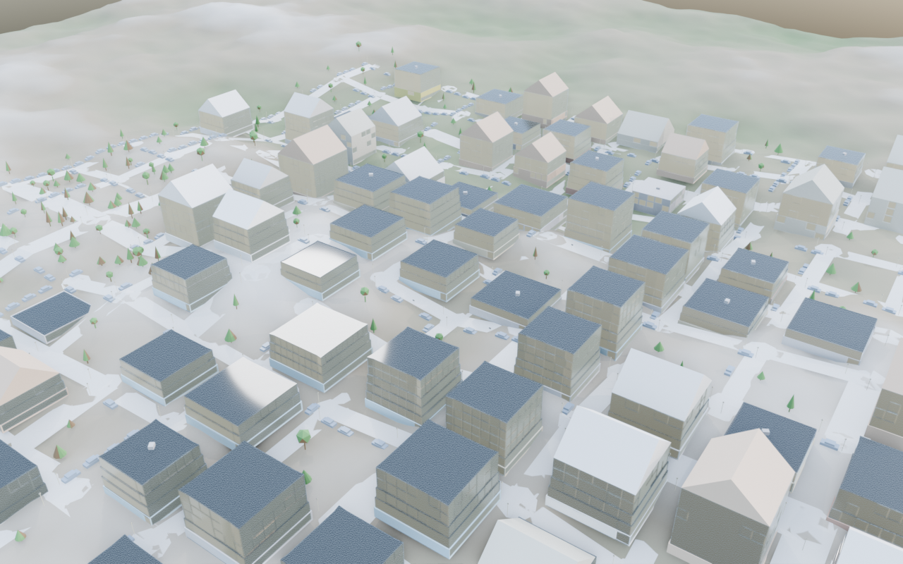

**Live Blender session — actual screenshot, grain clearly visible on facades:**
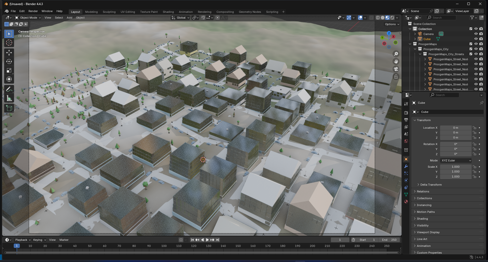

---

## v0.3.1 — Fixed remaining block/building overlaps in raster-mode presets

A live-session screenshot on Metropole showed buildings visibly overlapping
each other - a bug the v0.3.0 prop/building overlap fix didn't cover, since
that fix only kept *props* out of buildings, not buildings out of each
other. Root cause: raster-mode blocks (Metropole, Industrial) are built
from the axis-aligned bounding box of an irregular Voronoi-like cell, and
for non-convex or oddly-shaped cells that bbox can still extend into a
neighboring seed's actual territory even after the existing fill-factor
shrink - so two blocks (and the buildings placed on them) could overlap.
Grid-mode presets (Dorf, Kleinstadt) were never affected. Measured 156
overlapping block pairs / 41 overlapping buildings on Metropole and 37 / 11
on Industrial before the fix.

Rather than trying to reconstruct the true (possibly concave) cell polygon
just for a tighter initial estimate, `generate_layout` now resolves the
*invariant* directly: any pair of blocks whose rectangles still overlap
gets shrunk along whichever axis has the smaller overlap until their
projections on that axis no longer intersect, which by the AABB
separating-axis test guarantees no overlap regardless of the other axis.
A few passes settle chains of mutually-touching blocks. Blocks shrunk down
to a sliver by this process are dropped. Verified 0 block and 0 building
overlaps across all 4 presets, with a regression test added.

**Metropole, seed 1 — rendered (raytracing enabled, no more transmission ghosting either):**
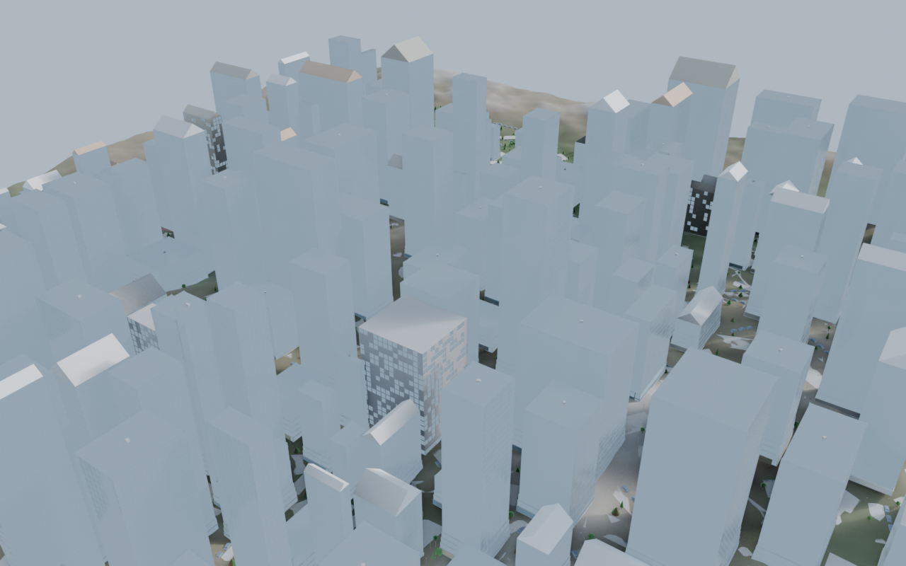

**Live Blender session — actual screenshot:**
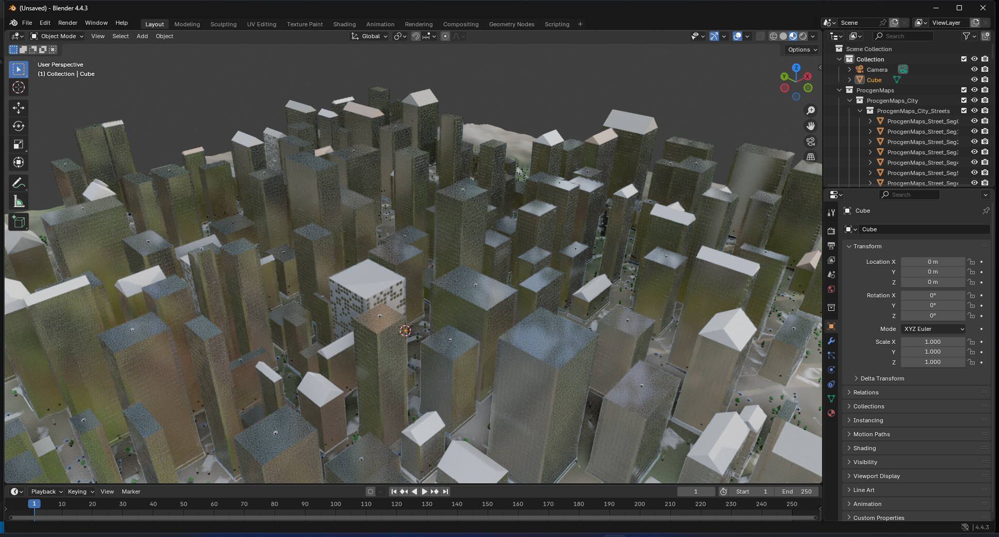

---

## v0.3.0 — Detail pass, ground-floor interiors, overlap fix

Building facades got real per-instance variety (jittered window frequency/
pitch/floor height so same-facade buildings stop looking identical), a
proper wide entrance recess on the ground floor, and a chance at a rooftop
utility unit on flat-roofed buildings. Every building now gets a simple
furnished ground-floor interior (floor, ceiling, warm light, 2-3
facade-appropriate furniture pieces from a new catalog) visible through
actually-transmissive window glass. Also fixed two real bugs surfaced by
this pass: props could still spawn overlapping buildings in the denser
raster-layout presets (Metropole, Industrial) because `SpatialHashGrid`'s
collision search radius didn't account for large registered items (like a
building's bounding circle) — only the query's own small radius. Verified
0 overlaps across all 4 presets after the fix, with a regression test
locking it in.

**Kleinstadt, seed 21 — rendered:**
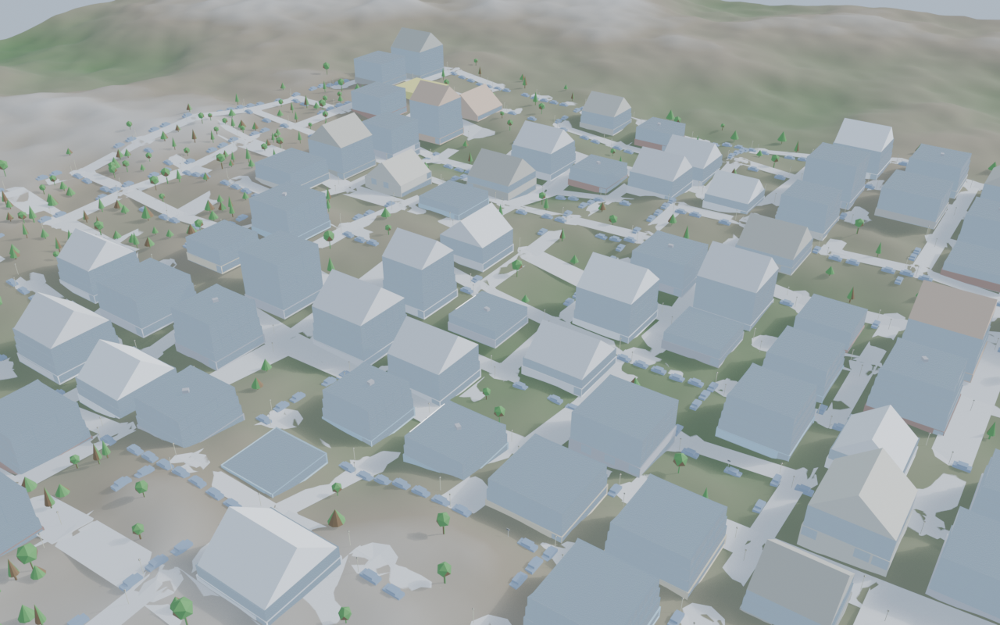

**Live Blender session — actual screenshot, not a render:**
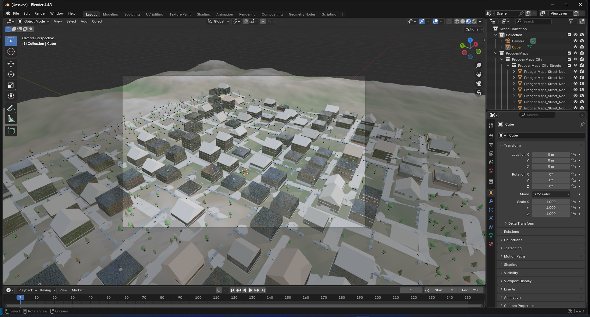

**Dorf, seed 30 — rendered:**
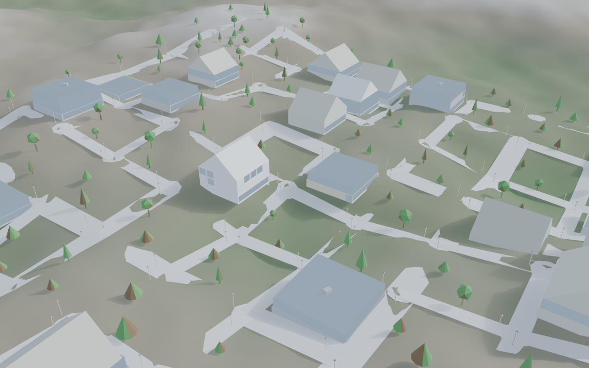

**Kleinstadt, seed 30, night mode:**


---

## v0.2.0 — Core bug fixes: grounded props, real materials, working windows/roofs

Fixed the issues visible in the first end-to-end test: props (trees, lamps,
benches) were floating above or buried under sloped terrain because
`props.py` hardcoded z=0 instead of sampling the heightmap; nothing had a
real material assigned (props showed as flat gray, and Blender's Solid
viewport shading ignores shader node graphs entirely, reading a separate
`diffuse_color` field instead); and — the deepest bug of this round —
window/roof detail had never actually rendered because of a `bmesh` quirk:
`extrude_face_region`'s own return value only reports the single moved top
face and silently drops the 4 newly-created side faces every time, so the
window-carving code had been running against nothing since it was written.
Fixed with a proper before/after face diff, added a real gable roof (ridge +
two slopes, not a single-point pyramid poke), and nested `ProcgenMaps_City`
correctly under the addon's root collection instead of as a stray sibling.

**Dorf, seed 7:**


**Metropole, seed 1:**


---

## v0.1.0 — Initial functional build

First end-to-end pass: 4 presets, terrain, the full layout → zones → streets
→ buildings → props pipeline, a BSP dungeon generator, and glTF/FBX/USDZ/
SVG/JSON export, all verified via a headless Blender smoke test. Visually
rough: props floating/buried relative to terrain, flat gray materials, and
buildings that were plain extruded boxes with no visible window or roof
detail — the issues v0.2.0 above fixes. No image captured for this
milestone (issues were reported via a live screenshot in conversation,
not saved to a file at the time).

---

## Reproducing any of these

```
blender --background --factory-startup --python your_script.py
```
```python
import procgen_maps
procgen_maps.register()
bpy.context.scene.procgen_maps.preset = "KLEINSTADT"  # or DORF / METROPOLE / INDUSTRIAL
bpy.context.scene.procgen_maps.seed = 21
bpy.ops.procgen_maps.generate_terrain()
bpy.ops.procgen_maps.generate_city()
```
See DEPLOYMENT.md for the full headless workflow.
