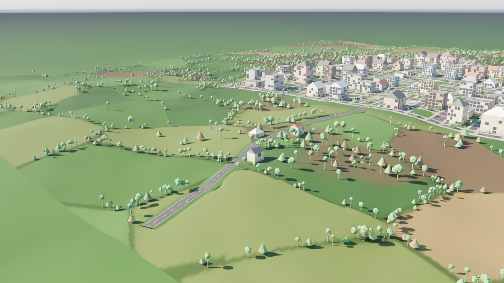
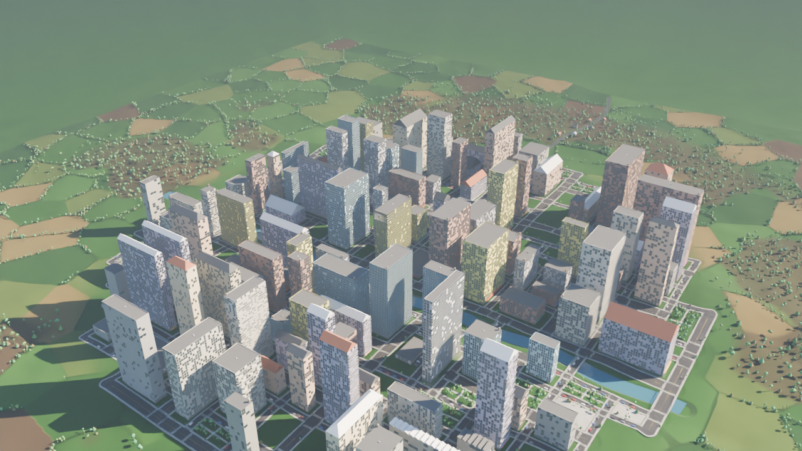
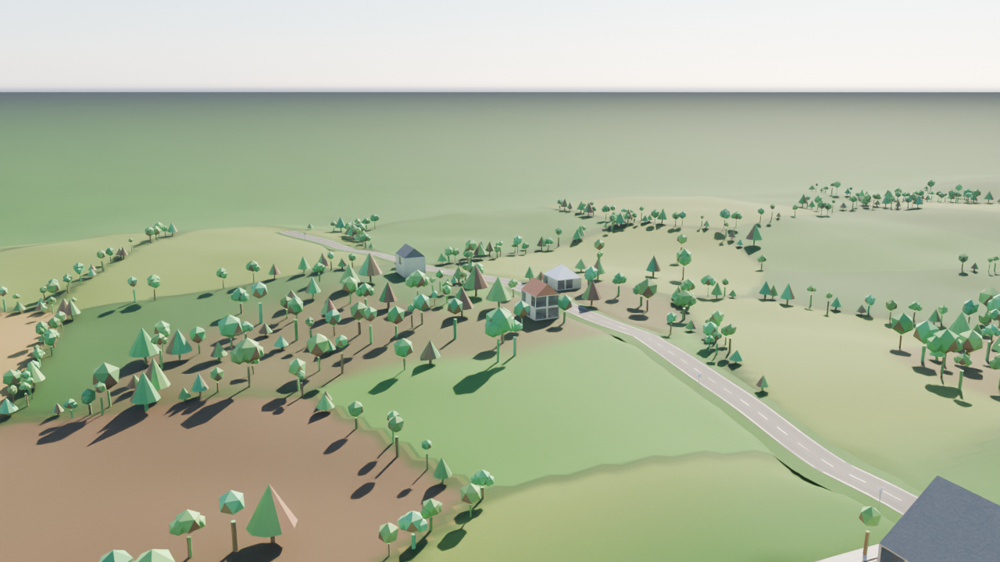

# Procgen Maps

[](LICENSE)



**Procgen Maps** is a Blender add-on that generates a whole map in a few
seconds: a city with streets, buildings, parks, a river and its bridges,
sitting on a terrain with fields, hedgerows and woods around it - plus a
separate multi-level dungeon - and exports it as a game-ready glTF
(colliders, LODs, walkable ground), FBX, USDZ, a 2D SVG map or JSON.
Everything is procedural (no texture or model files), deterministic per
seed, and runs headless as well as in the editor. Targets Blender 4.2+
(tested on 4.5 LTS in CI and 5.2 LTS locally).

| | |
|---|---|
|  |  |

A 10 s flyover: [docs/progression/v0.15.0-flyover.mp4](docs/progression/v0.15.0-flyover.mp4).
The full visual history, version by version, is in [`PROGRESSION.md`](PROGRESSION.md).

## What it generates

**City.** Four archetype presets (Metropole, Kleinstadt, Dorf,
Industrial) drive a pipeline of pure-Python planning stages - layout
(jittered grid or irregular raster, always one connected street network)
-> zones -> street graph -> setbacks -> buildings -> parks -> props ->
signage - followed by thin Blender build steps:

- **Streets**: one mesh for the whole network; asphalt with procedural
  markings (dashed/double centre lines, lane dividers, zebra crossings,
  wear), raised sidewalks with curbs and corner pieces, intersection
  fans, parked cars in the kerbside lane, lamps and trees on the
  sidewalk. The terrain is sunk under every street so no ground pokes
  through.
- **Buildings**: 12 facade archetypes (glass tower, office block, brick
  commercial, apartment slab/tower, townhouse, cottage, shopfront,
  warehouse, factory hall, industrial tower, mixed use) extruded floor by
  floor with real window columns, balconies, awnings and sign boards,
  flat / gabled / hipped / sawtooth roofs with tanks and masts, furnished
  ground floors behind transmissive glass, and a shared weathered facade
  shader. Five special buildings (supermarket with parking lot, police
  station, hospital with helipad, fire station, school) with lit signs.
- **Night mode**: lit windows that read as apartments and office floors
  (warm/cool, dark floors, contiguous runs), point lights on every lamp,
  the sun dipped below the horizon - one toggle, no regenerate.
- **Parks and plazas**, a **river** with sloped banks and bridges, and
  **street signage** (stop, speed limit, street names) from rule-based
  placement.

**Countryside.** A country road leaves the city to the map edge past a
village of cottages. The ground outside the city is a patchwork of field
cells in their own tones (meadow, crop, barley, stubble, ploughed earth)
with hedgerows and trees along the field borders, woods in clumps with a
humus floor under the trees, rock on slopes and snow on real peaks; the
map ends in a horizon that fades into the haze instead of a cliff.

**Dungeon.** A BSP dungeon on up to four stacked levels joined by
staircases, in a crypt, cave or castle theme: doors with lintels,
pillared halls, a boss dais, sarcophagi / boulders / banners, wall
torches and a fill light per room.

**Rendering.** A procedural physical sky (no HDRI), AgX colour
management, one shared aerial-perspective node group, lighting presets
(Afternoon, Midday, Golden Hour, Soft Overcast) with live sun / exposure
/ haze sliders, a one-click auto-framed **Showcase Render** (Cycles CPU,
denoised) and an interior view through a building's entrance.

**Export.** glTF/GLB with a City / Terrain / Dungeon hierarchy, box
colliders for buildings and props, trimesh colliders for ground, streets,
bridges and dungeon rooms, `_LOD0`/`_LOD1` groups and a navmesh-friendly
walkable mesh, in Godot (`-col`, `-colonly`, `-navmesh`) or Unity (`_col`,
`Collision` group) naming - the Blender scene is left untouched. Also
FBX, USDZ, a top-down SVG map and a JSON stats sidecar.

**Quality.** **Validate Map** checks a generated map for overlaps,
props or signs on the asphalt, disconnected streets, terrain above a
road surface, anything in the river, floating or buried objects and
orphan datablocks. The same validator runs in the test suite over 50
seeds x 4 presets, the dungeon's over 50 seeds x 3 themes; every bug fix
has a regression test. Custom presets save the whole panel state as JSON.

## Installation

1. Download the release zip (`procgen_maps-vX.Y.Z.zip`) from the Releases
   page, or build one from a clone with
   `python procgen_maps/scripts/package_release.py` (writes `dist/`).
   If you zip by hand, zip the `procgen_maps/` folder itself so the
   archive contains `procgen_maps/__init__.py` at its top level.
2. In Blender: **Edit > Preferences > Add-ons > Install from Disk...** and
   pick the zip.
3. Enable **Procgen Maps** in the add-on list.

No extra Python packages are needed: the add-on uses only `numpy` (bundled
with Blender) and Blender's own `bpy` / `bmesh` / `mathutils` - no scipy,
on purpose.

## Quick start

1. Press `N` in the 3D Viewport and open the **Procgen Maps** tab.
2. Pick a preset and a seed (the dice button picks a random one).
3. Click **Generate All**. A Kleinstadt takes a few seconds, a Metropole
   about ten; the viewport switches to Material Preview with the scene's
   sky so you see the real materials. The console prints one timed line
   per stage.
4. Try **Night Mode**, the **Lighting** presets and sliders (they apply
   live), and **Generate Dungeon** with a theme and level count.
5. **Showcase Render** writes an auto-framed Cycles still into the export
   directory; **Export** writes the glTF (with the game-engine options in
   the box), FBX, USDZ, SVG or JSON.
6. **Validate & Stats** checks the map and shows object / vertex counts
   and the last generate time. **Custom Presets** saves the current panel
   state under a name and loads it back later (JSON files in Blender's
   user config folder; the folder button opens it).

Headless use: `blender --background --python your_script.py` with
`import procgen_maps; procgen_maps.register()` and the same
`bpy.ops.procgen_maps.*` operators - see `DEPLOYMENT.md` and the smoke
test in `procgen_maps/tests/blender_integration/`.

## Project layout

```
procgen_maps/
  config/        presets (the four archetypes), global settings, custom-preset files
  generators/    terrain, landscape (fields/hedges/woods), city/ (layout, zones, streets,
                 buildings, parks, water, props, signage, countryside, ...), dungeon
  materials/     procedural shaders: facade, window, roof, road, sidewalk, terrain, props,
                 dungeon, sky world, aerial perspective
  assets/        placeholder prop meshes + instance-collection factory with LOD
  rendering/     camera framing + showcase render
  exporters/     game glTF, FBX, USDZ, SVG, JSON
  ui/            property group, operators, panels
  validation.py  the map validator (pure-Python plan checks + scene checks)
  tests/         pytest suite (no Blender needed) + the headless smoke test
```

`ARCHITECTURE.md` explains the pure-Python / bpy split every module
follows and the data flow between the stages; `OPTIMIZATION.md` has the
profiles; `DEPLOYMENT.md` covers headless runs and CI; `ROADMAP.md` what
is next; `CHANGELOG.md` what changed per version.

## Development

```
pip install numpy pytest
python -m pytest procgen_maps -q                       # ~250 tests, pure Python
blender --background --factory-startup \
    --python procgen_maps/tests/blender_integration/run_smoke_tests.py
```

The smoke test registers the add-on, generates terrain / city / dungeon
twice (leak check), validates, exports every format, re-imports the GLB
and renders two tiny Cycles frames; it exits non-zero on any failure.
Read `ARCHITECTURE.md` before sending a pull request.

## License

GPL-3.0-or-later. See `LICENSE`.
